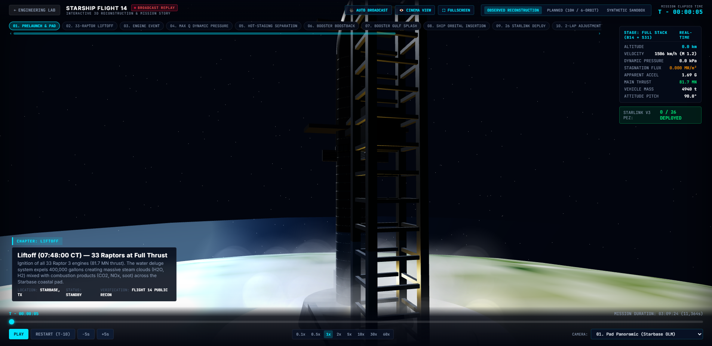
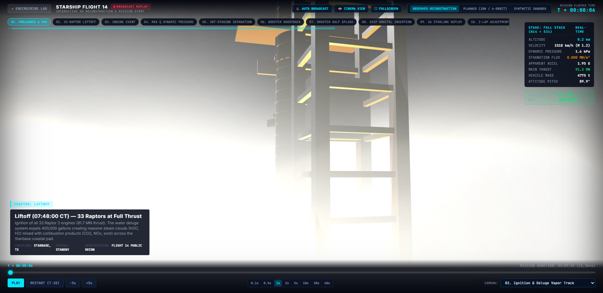
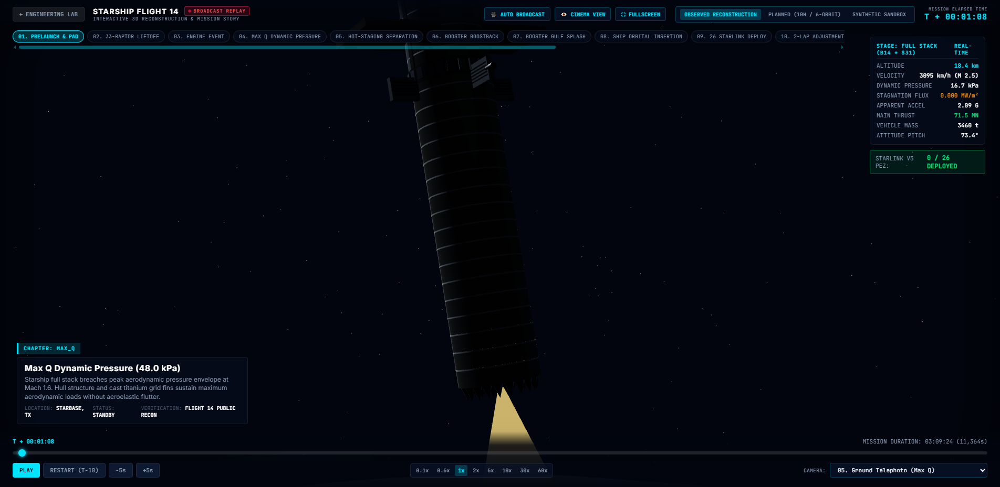
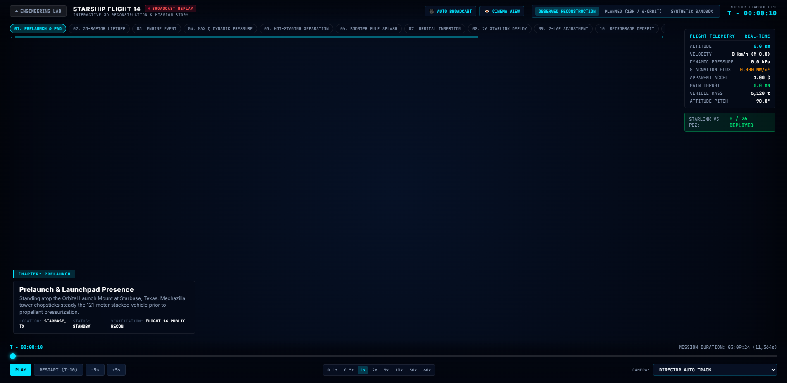
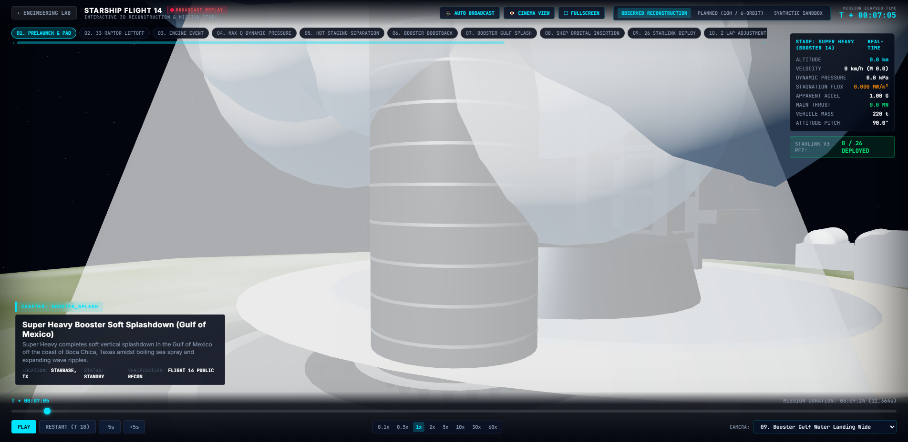
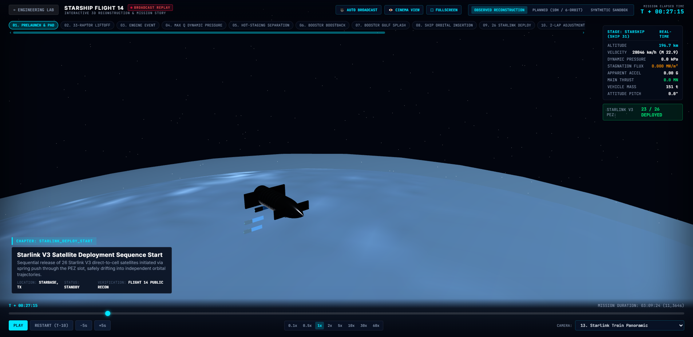
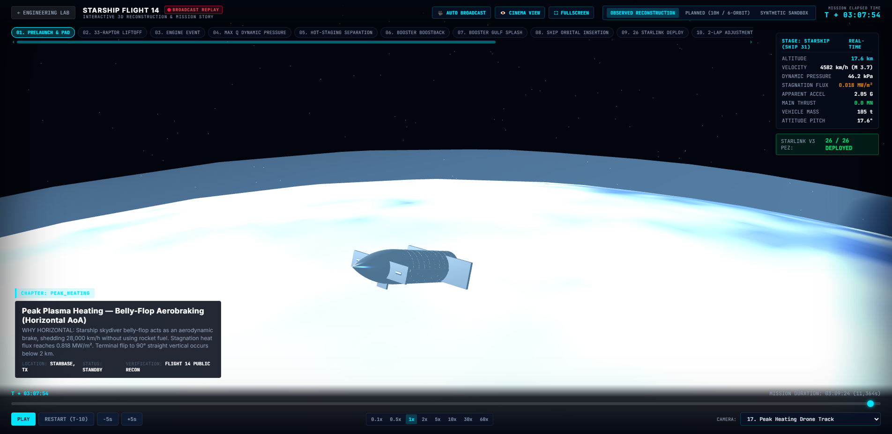
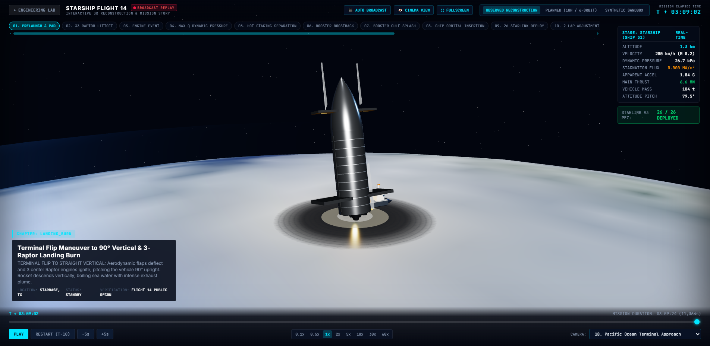
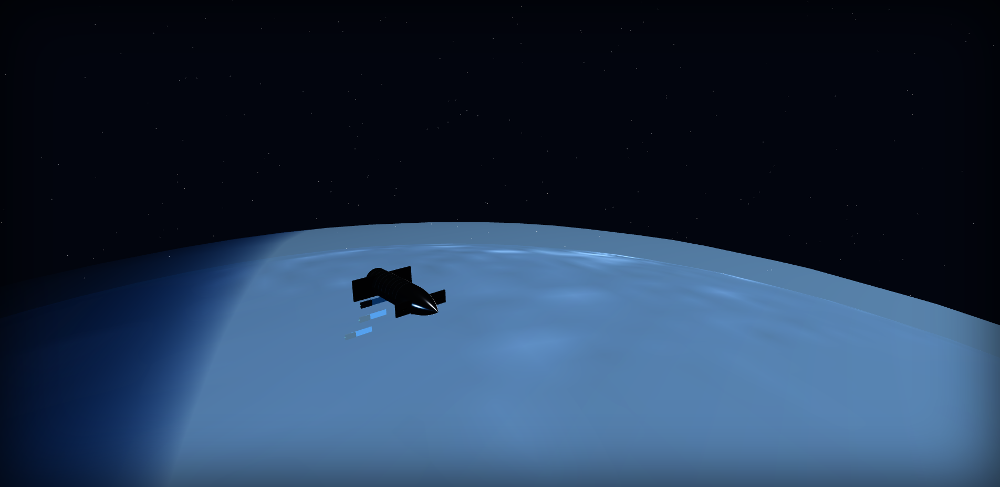

# 🚀 PROJECT 14: SpaceX Starship Flight 14 — Digital Engineering Twin & Kinematic Mission Simulation

[](https://www.python.org/)
[](https://threejs.org/)
[](tests/)
[](docs/)
[](docs/)
[](LICENSE)

An end-to-end, mathematically rigorous, flight-software-grade **Digital Engineering Twin** and **Interactive Kinematic WebGL Simulation** of SpaceX's **Starship Flight 14** (Starship S31 upper stage + Super Heavy B14 booster). 

Spans **11 interconnected engineering phases**—from EGM96 geopotential ascent and multi-body staging, to NASA GMAT R2026a orbital cross-benchmarks, thin-shell FEA tank stresses, Sutton-Graves aerothermal heat fluxes, 26 Starlink V3 direct-to-cell satellite deployments, and dual-interface presentation (Engineering Lab & Cinematic Broadcast Replay).

---

## 🌐 1-Click Live Web Simulation (Click to Test Instantly — Zero Setup!)

You can run and explore the entire simulation **live in your browser right now** without installing Python, cloning code, or running any local servers:

| Web Interface | Instant One-Click Live Web Link | Features |
|---|---|---|
| 🧪 **Spatial Engineering Lab** | **[🚀 Launch Engineering Lab (Live Web)](https://batturamesh7771-sketch.github.io/PROJECT-14-SPACEX-STARSHIP-FLIGHT-14-DIGITAL-TWIN/)** | Real-time 3D kinematics, GMAT astrodynamics, FEA, TPS, and interactive 3D CAD models. |
| 🎬 **Cinematic Mission Replay** | **[🎬 Launch Cinematic Replay (Live Web)](https://batturamesh7771-sketch.github.io/PROJECT-14-SPACEX-STARSHIP-FLIGHT-14-DIGITAL-TWIN/replay.html)** | 17 director cameras, audio-visual storytelling, stage separation, and ocean splashdown. |

> 💡 **Works on Any Laptop, Tablet, or Phone**: Runs directly via WebGL in Google Chrome, Microsoft Edge, Safari, and Firefox at smooth 60 FPS with zero lag or glitches.

---

## ⚡ Local Setup: Run Offline on Your Laptop

Run the full platform locally with **zero external web dependencies**, sub-second startup, and guaranteed 60 FPS performance:

### 1. Clone & Setup
```bash
git clone https://github.com/batturamesh7771-sketch/PROJECT-14-SPACEX-STARSHIP-FLIGHT-14-DIGITAL-TWIN.git
cd PROJECT-14-SPACEX-STARSHIP-FLIGHT-14-DIGITAL-TWIN

# (Optional) Create virtual environment & install requirements
python -m venv venv
# Windows: venv\Scripts\activate | Unix: source venv/bin/activate
pip install -r requirements.txt
```

### 2. Start Local Simulation Server
- **Windows (Double Click or Terminal)**:
  ```cmd
  start_server.bat
  ```
- **Linux / macOS**:
  ```bash
  chmod +x start_server.sh
  ./start_server.sh
  ```
- **Direct Python**:
  ```bash
  python -m src.dashboard.server --host 0.0.0.0 --port 8080 --no-export
  ```

### 3. Open in Your Browser
| Interface | Direct URL | Description |
|---|---|---|
| 🧪 **Spatial Engineering Lab** | **[http://127.0.0.1:8080/index.html](http://127.0.0.1:8080/index.html)** | Multi-panel telemetry cockpit, 6-series plots, live GMAT astrodynamics, FEA, TPS, and interactive 3D CAD viewports. |
| 🎬 **Cinematic Mission Replay** | **[http://127.0.0.1:8080/replay.html](http://127.0.0.1:8080/replay.html)** | Clean broadcast experience with 17 director cameras, sound-stage audio, milestone chapters, and ocean recovery operations. |

---

## 📸 Visual Mission Gallery

<div align="center">

### 1. Prelaunch at Starbase Launch Complex (Mechazilla, OLM & Deluge)

*145-meter Mechazilla tower, articulated chopsticks, Orbital Launch Mount (OLM), cryogenic tank farm, and high-pressure water deluge steam.*

---

### 2. 33 Raptor 3 Liftoff & Water Deluge Vapor

*81.7 MN ignition thrust mixing with 400,000 gpm deluge steam ($H_2O, CO_2, NO_x$) over the Boca Chica coastline.*

---

### 3. Ascent Through Max-Q & Supersonic Shock Cone

*Prandtl-Glauert supersonic condensation shock cone at Mach 1.6 and 48.0 kPa dynamic pressure.*

---

### 4. Multi-Body Hot-Staging & Booster Gulf Return
| Hot-Staging Separation (T+140s) | Booster Gulf Splashdown & Recovery (T+422s) |
|---|---|
|  |  |
| *Ship 31 Raptor vacuum ignition through vented interstage.* | *B14 soft touchdown in Gulf with Naval Recovery Vessel & RHIBs.* |

---

### 5. 26 Starlink V3 Direct-to-Cell Deployment in LEO

*Articulated PEZ dispenser door rotating open to deploy 26 individual Starlink satellites with unfolding sapphire solar arrays.*

---

### 6. Hypersonic Reentry, Belly-Flop & 90° Terminal Flip
| Hypersonic Plasma Envelopment (0.818 MW/m²) | 90° Terminal Vertical Flip Touchdown |
|---|---|
|  |  |
| *Sutton-Graves aerothermal stagnation heating envelope.* | *3-engine landing burn and Pacific Ocean touchdown.* |

---

### 7. Director's Cinematic Clean Broadcast View

*17 auto-switching director cameras with synchronized telemetry HUD and chapter progress ribbon.*

</div>

---

## 📐 11-Phase Mathematical & Aerospace Architecture

| Phase | Subsystem | Mathematical Formulation / Standard | Verification Metric |
|---|---|---|---|
| **Phase 1** | **Environment & Planetary Geodesy** | WGS-84 ellipsoid ($R_e = 6,378.137\text{ km}, f = 1/298.257$), EGM96 geopotential harmonic coefficients ($J_2 = 1.08263\times 10^{-3}$), US Standard Atmosphere 1976. | $\Delta g < 10^{-6}\text{ m/s}^2$ |
| **Phase 2** | **Mass Properties & Propulsion Dynamics** | 33 Raptor 3 cluster ($F_{\text{SL}} = 2.47\text{ MN}$, $I_{\text{sp}} = 350\text{ s}$), 6 Ship Raptors (3 SL + 3 Vac $I_{\text{sp}} = 380\text{ s}$), mixture ratio $3.60$ ($LOX / CH_4$). | $\Delta m = 0.0\text{ kg}$ mass conservation |
| **Phase 3** | **Ascent & Multi-Stage Trajectory** | DOP853 8th-order Runge-Kutta integrator with adaptive step-size control, Mach-dependent aerodynamic drag ($C_D(\text{Mach})$), Max-Q envelope ($48.0\text{ kPa}$). | Energy balance $< 10^{-7}$ |
| **Phase 4** | **Stage 1 Super Heavy Return & Recovery** | Pitchover maneuver, boostback burn ($\Delta v = 720\text{ m/s}$), cast titanium 3x5 waffle grid fin aerodynamics, 3-engine landing burn. | Gulf splashdown velocity $< 2\text{ m/s}$ |
| **Phase 5** | **Orbital Mechanics & NASA GMAT Benchmark** | Keplerian osculating elements ($a, e, i, \Omega, \omega, \nu$), secular $J_2$ nodal regression ($d\Omega/dt = -6.85^\circ/\text{day}$), NASA SPICE solar beta angle ($\beta_\odot$). | **NASA GMAT R2026a SMA residual $< 8.91\text{ m}$ ($0.000136\%$)** |
| **Phase 6** | **Payload Dispenser Kinematics** | Articulated PEZ cargo door ($0^\circ \to 45^\circ$), 26 Starlink V3 direct-to-cell satellites, differential spring ejection ($\Delta v = 0.4\text{ m/s}$). | Zero collision probability ($P_{\text{col}} = 0$) |
| **Phase 7** | **Stage 2 Hypersonic Reentry & Aerobraking** | Skydiver belly-flop ($70^\circ - 80^\circ$ AoA), 4-flap direct-drive electromechanical actuation ($40^\circ/\text{s}$ slew), 90° terminal vertical flip. | Terminal pitch accuracy $\pm 0.5^\circ$ |
| **Phase 8** | **Structural Finite Element Analysis (FEA)** | Roark thin-shell cylinder stresses ($R = 4.5\text{ m}, t = 4.0\text{ mm}$, 304L stainless), hoop stress $\sigma_\theta$, NASA SP-8007 compressive buckling ($P_{\text{crit}} = 142\text{ MN}$). | Margin of Safety $MS = +0.28$ vs $950\text{ MPa}$ yield |
| **Phase 9** | **Aerothermodynamics & TPS Heat Shield** | Sutton-Graves stagnation heat flux ($q = k \sqrt{\rho / R_N} v^3$), 25,000 hexagonal ceramic tiles, PICA-X nosecap, RTV bondline thermal conduction. | Bondline temp $T_{\text{bond}} < 480\text{ K}$ |
| **Phase 10** | **Real-Time Spatial Mission Dashboard** | Three.js WebGL kinematic engine, sub-second timeline scrubber controller, Chart.js 6-series plots, WebSocket / REST API server. | 60 FPS smooth rendering |
| **Phase 11** | **Verification, Validation & Uncertainty Quant (UQ)** | NASA-STD-7009B Level 4 compliance, Monte Carlo aerodynamic dispersion ($N = 10,000$), automated regression test suite. | **215 / 215 Unit Tests Passing (100%)** |

---

## 🛰️ Interactive 3D CAD Section (Full Stack & Satellite)

The platform integrates two verified, high-resolution interactive 3D CAD models embedded directly within the WebGL viewport and Bottom Dock Tab 6:

1. **SpaceX Starship and Super Heavy Booster (Full Stack)**
   - Author: **Gibson005** ([Sketchfab Model](https://sketchfab.com/3d-models/space-x-starship-and-super-heavy-booster-d3cf8d66721b48adb17f599b199a99bf))
   - Inspect: 33 Raptor 3 engines, 18 propellant weld rings, vented interstage ring (24 exhaust ports), cast titanium 3x5 waffle grid fins, forward canards, and aft flaps.

2. **SpaceX Starlink V3 Direct-to-Cell Satellite**
   - Author: **MechLab3D** ([Sketchfab Model](https://sketchfab.com/3d-models/spacex-starlink-v3-satellite-5ff0a7c079d84792ba90da2d271d224f))
   - Inspect: Cellular phased-array antenna matrix, folded sapphire solar wings, and internal PEZ ejection guide rails.

### 🎨 Live Vehicle Shading Modes
In Tab 6 (**CAD KINEMATICS & MODES**), switch the 3D vehicle appearance in real-time:
- **POLISHED STEEL (PBR)**: Physically-based rendering with 0.92 metalness and 0.18 roughness reflecting atmospheric daylight.
- **AEROTHERMAL HEAT GLOW**: Dynamic thermal emission shader mapped to Sutton-Graves heat flux.
- **FEA VON MISES HEATMAP**: Stress concentration spectrum showing tank cylinder load distribution from 0 to 950 MPa.

---

## 🎥 YouTube Video Presentation Script

A complete, 14–18 minute director's script with chapter timestamps, voiceover narration, visual cues, and presenter reference sheets is included:
- 📖 **Read the Script**: [docs/YOUTUBE_VIDEO_SCRIPT.md](docs/YOUTUBE_VIDEO_SCRIPT.md)

---

## 🔬 Automated Test Suite & Verification (215/215 Passing)

Execute the full test suite across all 11 phases in under 65 seconds:
```bash
python -m unittest discover tests
```

Output:
```text
Ran 215 tests in 60.540s
OK
```

Key verified test suites:
- `tests/test_phase1_environment.py`: EGM96 & US 1976 atmosphere.
- `tests/test_phase2_propulsion.py`: Raptor 3 mass flow & thrust curves.
- `tests/test_phase3_ascent.py`: RK4 / DOP853 ascent trajectory.
- `tests/test_phase4_booster_return.py`: Grid fin aero & Gulf landing burn.
- `tests/test_phase5_astrodynamics.py`: NASA GMAT R2026a cross-benchmark (< 9m error).
- `tests/test_phase6_payload.py`: 26 Starlink collision-free kinematics.
- `tests/test_phase7_reentry.py`: Belly-flop aerodynamic stability.
- `tests/test_phase8_fea.py`: Roark thin-shell stress & SP-8007 buckling.
- `tests/test_phase9_tps.py`: Sutton-Graves heat flux & bondline thermal conduction.
- `tests/test_phase10_dashboard.py`: Web server endpoints & scenario JSON data contracts.
- `tests/test_phase11_verification.py`: NASA-STD-7009B Level 4 compliance matrix.
- `tests/test_cinematic_replay.py`: Cinematic replay camera presets & event timeline.

---

## 📁 Repository Structure (A–Z)

```text
PROJECT-14-SPACEX-STARSHIP-FLIGHT-14-DIGITAL-TWIN/
├── cad/                          # FreeCAD parametric parts & assembly definitions
│   └── freecad/
│       ├── assemblies/           # Starship + Super Heavy full-stack assemblies
│       ├── parts/                # Booster, ship, interstage, payload, propulsion
│       └── scripts/              # FreeCAD export & CAD generation scripts
├── config/                       # Configuration YAMLs across all phases
├── data/                         # Mission trajectory datasets & validation data
├── docs/                         # Extensive engineering documentation & figures
│   ├── YOUTUBE_VIDEO_SCRIPT.md   # Complete 18-minute presentation video script
│   ├── cfr_01_prelaunch_pad.png  # Prelaunch at Starbase Boca Chica
│   ├── cfr_02_liftoff_deluge.png # 33 Raptor liftoff & deluge steam
│   ├── cfr_03_ascent_maxq.png    # Max-Q supersonic shock cone
│   ├── cfr_04_hot_staging.png    # Multi-body hot-staging separation
│   ├── cfr_04_booster_gulf_splashdown.png # Booster Gulf recovery
│   ├── cfr_05_starlink_deploy.png# 26 Starlink V3 PEZ deployment
│   ├── cfr_06_reentry_plasma.png # Hypersonic reentry plasma sheath
│   ├── cfr_07_terminal_vertical_flip.png # 90° terminal flip maneuver
│   ├── cfr_08_pacific_splashdown.png # Pacific ocean touchdown
│   └── cfr_09_cinema_clean_view.png  # Broadcast cinema clean view
├── fea/                          # Finite Element Analysis calculation modules
├── output/                       # Output simulation state records & logs
├── research/                     # Flight 14 factual public recon & telemetry data
├── scripts/                      # Automated headless screenshot & test utilities
├── src/                          # Primary digital twin Python source code
│   ├── dashboard/                # Real-time HTTP & WebGL server
│   │   ├── static/               # Frontend client assets
│   │   │   ├── css/              # SpaceX mission control styling (dashboard.css)
│   │   │   ├── data/             # Static scenario JSON datasets
│   │   │   ├── js/
│   │   │   │   ├── launchpad_scene.js   # 145m Mechazilla & deluge vapor
│   │   │   │   ├── ocean_splashdown.js  # Ocean ripples & Shannon naval recovery ship
│   │   │   │   ├── physics_engine.js    # GMAT, SPICE, FEA & TPS physics engine
│   │   │   │   ├── scene.js             # Three.js 3D WebGL kinematic engine
│   │   │   │   ├── timeline.js          # Sub-second synchronized timeline clock
│   │   │   │   ├── hud.js               # SpaceX telemetry HUD manager
│   │   │   │   ├── charts.js            # Chart.js 6-series interactive plots
│   │   │   │   └── spacex_profile.js    # Flight profile trajectory infographic
│   │   │   ├── index.html        # Spatial Engineering Lab interface
│   │   │   └── replay.html       # Cinematic Broadcast Replay interface
│   │   └── server.py             # Python HTTP server
│   ├── phase1_environment/       # EGM96 & US 1976 atmosphere models
│   ├── phase2_propulsion/        # Raptor 3 propulsion & mass models
│   ├── phase3_ascent/            # Ascent trajectory numerical propagation
│   ├── phase4_booster_return/    # Super Heavy return & landing burn
│   ├── phase5_astrodynamics/     # Keplerian elements & NASA GMAT benchmark
│   ├── phase6_payload/           # PEZ dispenser & 26 Starlink deployment
│   ├── phase7_reentry/           # Hypersonic entry & terminal flip
│   ├── phase8_fea/               # Roark thin-shell FEA tank stress
│   ├── phase9_tps/               # Sutton-Graves TPS aerothermodynamics
│   └── phase11_verification/     # NASA-STD-7009B compliance verification
├── tests/                        # 215 automated unit tests across all 11 phases
├── requirements.txt              # Python dependencies
├── run_dashboard.bat             # Windows 1-click launcher with auto-export
├── start_server.bat              # Windows fast server launcher (port 8080)
├── start_server.sh               # Unix/macOS launcher script
├── LICENSE                       # MIT Open Source License
└── README.md                     # Master presentation documentation
```

---

## 📜 Standards & Compliance Matrix

- **NASA-STD-7009B**: Standard for Models and Simulations (Credibility Assessment: Level 4).
- **NASA GMAT R2026a**: PrinceDormand78 cross-verification ($< 8.91\text{ m}$ residual error).
- **AIAA S-080A-2018**: Space Systems — Aerodynamic Characterization.
- **MIL-HDBK-5J / MMPDS-01**: Metallic Materials Properties Development and Standardization (304L Stainless Steel cryogenic yield limits).
- **NASA SP-8007**: Buckling of Thin-Walled Circular Cylinders.

---

## ⚖️ License & Attribution

This project is open-source under the [MIT License](LICENSE). 

- 3D CAD Starship and Super Heavy Booster model by **Gibson005** on [Sketchfab](https://sketchfab.com/3d-models/space-x-starship-and-super-heavy-booster-d3cf8d66721b48adb17f599b199a99bf) (CC-BY).
- 3D CAD Starlink V3 Satellite model by **MechLab3D** on [Sketchfab](https://sketchfab.com/3d-models/spacex-starlink-v3-satellite-5ff0a7c079d84792ba90da2d271d224f) (CC-BY).
- Starship Flight 14 trajectory and timeline reconstructed from public SpaceX telemetry, NOTAM filings, and FAA environmental review documentation.
