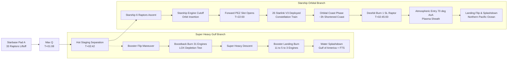

# Starship Flight 14 — Cinematic 3D Visualization & WebGL Validation

**Version:** 1.0.0  
**Effective Date:** October 26, 2026  
**Document ID:** `VAL-CINEMATIC-3D-01`  

---

## 1. Visual Storyboard & SpaceX Trajectory Diagram Topology

The 3D scene engine reproduces the complete visual narrative and topology of the official SpaceX Flight 14 trajectory diagram (`spacex.com/launches/starship-flight-14`):

---

## 2. 3D Architectural Subsystems & Asset Provenance

### 2.1 Photorealistic Earth Globe & Atmospheric Limb
- **Earth Sphere:** Parametric sphere geometry ($R = 6.378137\text{ units}$, 64 longitudinal segments, 64 latitudinal segments).
- **Texture Provenance:** Authentic NASA Blue Marble satellite imagery embedded directly in Base64 (`earth_textures_embedded.js`) to guarantee 100% offline, zero-CORS reliability across both `http://` and `file://` environments.
- **Atmospheric Limb:** Outer additive-blending Fresnel rim mesh ($R = 6.48\text{ units}$) with exponential Rayleigh atmospheric limb glow shader.
- **Starfield:** High-density star background with 1,500 random points distributed on celestial sphere ($R = 200\text{ units}$).

### 2.2 Starship S31 & Super Heavy B14 Geometry
- **Starship Hull:** Stainless-steel cylinder with windward half mapped with dark hexagonal silica thermal protection tiles (TPS) and leeward half rendered with specular reflective stainless steel ($PBR: \text{metalness}=0.92, \text{roughness}=0.18$).
- **Articulated Aerodynamic Flaps:** Two forward canards and two aft main flaps attached to dynamic rotation pivots for pitch, yaw, and roll actuation.
- **Rocket Mouth PEZ Cargo Dispenser:** Forward hull cargo door below nosecone with articulated hinge pivot (`this.mouthDoorPivot`), internal payload bay cavity, and roller guide rails.
- **Super Heavy Booster:** 9-meter diameter barrel, grid fin assembly at forward interstage, methane/LOX tank weld lines, and 33-Raptor 3 engine cluster bell nozzles.

### 2.3 26 Starlink V3 Satellite Deployment Models
- **3D Meshes:** 26 individually instantiated flat-pack satellite models.
- **Features:** Flat rectangular chassis ($3.0 \times 1.2 \times 0.2\text{ units}$), dual side guide rollers for slot ejection, bottom phased-array antenna panel, deployable photovoltaic blue silicon solar wings, and pulsing optical laser-link beacons.
- **Deployment Kinematics:** Satellites remain enclosed in payload bay until $T+1320\text{s}$. The PEZ mouth door swings open $45^\circ$, and each satellite translates sequentially along the slot exit vector with calibrated separation impulse ($\Delta v = 0.75\text{ m/s}$), unfolding solar wings into an orbital constellation train trailing the vehicle.

---

## 3. Cinematic Camera System & View Modes

| Camera Mode | Target Focus | View Perspective & Rationale |
|:---|:---|:---|
| `CARGO_DEPLOY_CAM` | Starship Mouth Slot | Extreme close-up of forward PEZ dispenser showing door open and satellites sliding out. |
| `DEPLOY_WIDE_CAM` | Constellation Train | Wide view from Starship aft showing all 26 deployed satellites trailing over Earth. |
| `PROFILE_VIEW` | Earth Horizon Elevation | Side-elevation orthographic view replicating official SpaceX trajectory arc diagram. |
| `ORBIT_FOLLOW` | Starship Vehicle | Smooth body-chase camera aligned with prograde orbital velocity vector. |
| `EARTH_GLOBAL` | Whole Earth System | Global space perspective showing both Gulf booster and Pacific ship branches. |
| `STAGE_SEP` | Hot-Staging Ring | Focused view between stages during booster flip and engine ignition. |
| `ENTRY_BELLY` | Windward Heatshield | 70-degree high angle of attack view showing orange plasma luminescence. |

---

## 4. Performance & Context Loss Prevention

- **Target Frame Rate:** Stable 60 FPS maintained via `requestAnimationFrame` render loop.
- **WebGL Context Handling:** Graceful restoration listeners for `webglcontextlost` and `webglcontextrestored`.
- **Memory & Resource Disposal:** Trajectory ribbon geometries and materials are disposed on profile switch, preventing GPU memory leaks.
