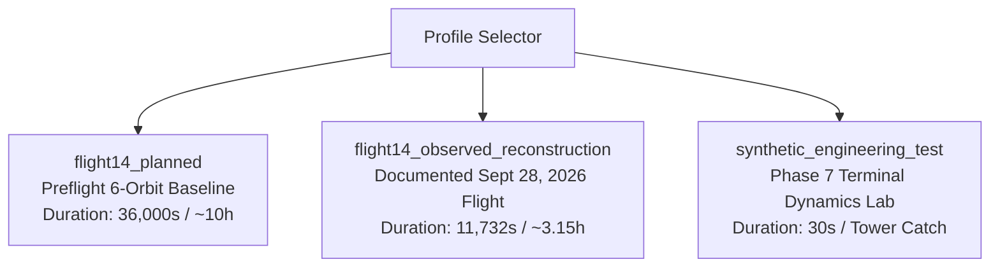

# Starship Flight 14 — Mission Profile Specification

**Version:** 1.0.0  
**Effective Date:** October 26, 2026  
**Status:** Authoritative Mission Architecture Document  

---

## 1. Profile Architecture & Isolation Rules

The application implements three strictly isolated mission profiles. Switching profiles completely resets and re-binds:
1. Active 3D trajectory ribbons (single stack, dual branching, or terminal tower catch).
2. Vehicle meshes and relative staging positions.
3. Master timeline bounds and milestone tick markers.
4. Telemetry channel histories, units, and ranges.
5. Systems health matrix and 33-Raptor engine states.
6. Starlink V3 payload counter and manifest table.
7. Verification metadata and provenance inspect drawers.

---

## 2. Profile A: `flight14_planned` (Preflight Baseline)

- **Purpose:** Source-backed reconstruction of the intended preflight baseline mission design published by SpaceX.
- **Duration:** $36,000.0\text{ s}$ ($10\text{ hours}$).
- **Target Orbit:** Circular parking orbit at $275\text{ km}$ geodetic altitude, inclination $28.5^\circ$, 6 full revolutions.
- **Payload:** 26 Starlink V3 flat-pack satellites ($1,500\text{ kg}$ each, $39.0\text{ tonnes}$ total payload mass).
- **Booster Branch:**
  - Liftoff from Starbase Pad A with 33 Raptor 3 engines.
  - Hot-staging at $T+162\text{s}$ at $69.4\text{ km}$ altitude.
  - Booster pitch-over flip and 31-engine boostback burn toward Gulf of America.
  - Booster atmospheric descent and 13-engine downselect landing burn to Gulf splashdown ($T+422\text{s}$).
- **Starship Branch:**
  - 6 Raptor engines (3 Sea-Level + 3 Vacuum) burn to orbital insertion ($T+522.35\text{s}$).
  - In-orbit circularization burn.
  - Starlink V3 deployment between $T+1320\text{s}$ and $T+1680\text{s}$ via forward PEZ mouth door.
  - 6 full orbital coast passes (~9 hours).
  - Deorbit burn at $T+34,200\text{s}$ using 1 Raptor Sea-Level engine.
  - Atmospheric entry interface ($T+35,280\text{s}$) at $70^\circ$ angle of attack.
  - Controlled aerodynamic belly flop, landing flip, and Pacific Ocean splashdown ($T+36,000\text{s}$).

---

## 3. Profile B: `flight14_observed_reconstruction` (Factual September 28, 2026 Flight)

- **Purpose:** Factual postflight digital twin adhering strictly to verified public evidence from the September 28, 2026 mission.
- **Duration:** $11,732.0\text{ s}$ ($3\text{ hours}, 15\text{ minutes}, 32\text{ seconds}$).
- **Achieved Orbit:** Passively safe initial suborbital transition ($185 \times 168\text{ km}$), raised via single Raptor sea-level burn to $275\text{ km}$ orbit around Earth.
- **Payload:** All 26 Starlink V3 satellites successfully deployed and operational via laser links.
- **Anomalies & Adaptations Documented:**
  - Single booster Raptor shutdown during powered climb ($T+45\text{s}$); compensated by remaining 32 engines.
  - Single Starship Raptor vacuum early shutdown during ascent; remaining 5 Raptors burned longer to achieve insertion.
  - Flight control decision to limit orbital duration to ~3 hours out of caution.
- **Milestone Timeline:**
  1. `T+00:00:00` (0.0 s): Liftoff with 33 Raptor 3 engines ignited at Starbase, TX.
  2. `T+00:00:45` (45.0 s): Booster Raptor engine shutdown during climb.
  3. `T+00:01:08` (68.0 s): Max Q aerodynamic peak stress ($32.48\text{ kPa}$).
  4. `T+00:02:40` (160.0 s): Super Heavy MECO.
  5. `T+00:02:42` (162.0 s): Hot-staging separation; Starship 6 Raptors ignite; dual trajectories diverge.
  6. `T+00:02:47` (167.0 s): Super Heavy directional flip and boostback burn (31 engines, LOX depletion test).
  7. `T+00:04:10` (250.0 s): Starship vacuum Raptor early shutdown; 5 remaining engines burn extended.
  8. `T+00:06:30` (390.0 s): Booster high-thrust landing burn (11 $\rightarrow$ 5 $\rightarrow$ 3 engines).
  9. `T+00:07:05` (425.0 s): Booster Gulf of America water splashdown; FTS safety hardware triggered.
  10. `T+00:08:42` (522.35 s): Starship orbital insertion complete.
  11. `T+00:15:00` (900.0 s): Starship single sea-level Raptor circularization burn to 275 km.
  12. `T+00:22:00` (1320.0 s): Starlink V3 forward PEZ mouth door opens.
  13. `T+00:28:00` (1680.0 s): All 26 Starlink V3 satellites deployed into orbital train.
  14. `T+02:45:00` (9900.0 s): Cautionary early deorbit burn executed with 1 Sea-Level Raptor.
  15. `T+03:00:00` (10,800.0 s): Atmospheric reentry interface (EI 120 km) at $70^\circ$ AoA with plasma glow.
  16. `T+03:08:00` (11,280.0 s): Aerodynamic forward/aft flap maneuvers and 3 Raptor landing flip burn.
  17. `T+03:15:32` (11,732.0 s): Northern Pacific Ocean splashdown (expended).

---

## 4. Profile C: `synthetic_engineering_test` (Phase 7 Reusable Landing Dynamics Lab)

- **Purpose:** Engineering physics sandbox for multi-body landing flip kinematics and terminal 3-to-1 throttle control allocation.
- **Duration:** $30.0\text{ s}$.
- **Synthetic Banner (Mandatory):**  
  `⚠️ SYNTHETIC EXPERIMENT — NOT FLIGHT 14 HISTORY. Isolated Phase 7 Terminal Landing Dynamics Simulation.`
- **Physical Characteristics:**
  - Initial condition: 1500 m AGL, $90^\circ$ angle of attack (horizontal belly-flop descent at terminal velocity $75\text{ m/s}$).
  - Flip maneuver: Rapid pitch slew to $0^\circ$ vertical using aerodynamic flaps and Raptor gimbal vectoring.
  - Propulsive throttle modulation: 3 Raptors ignite and throttle down to 1 engine for soft touchdown / catch tower demonstration.
