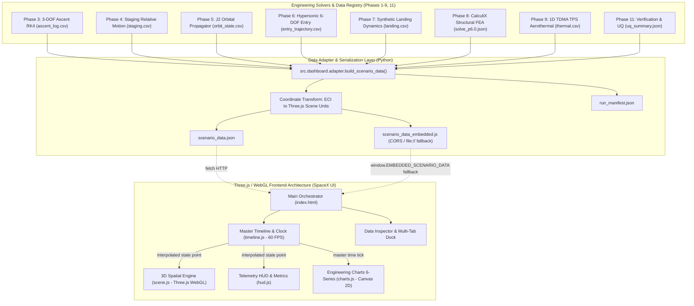

# Phase 10: Digital Engineering Spatial Dashboard — Architecture and Data Flow

**Document Version:** 2.0.0  
**Project:** Starship Flight 14 Digital Engineering Lab  
**Date:** 2026-10-25  

---

## 1. System Architecture Overview

The Phase 10 Digital Engineering Spatial Dashboard provides the unified 3D visualization, real-time playback orchestration, and multi-panel telemetry telemetry interface over the simulation outputs of Phases 1 through 11.

---

## 2. Coordinate Transformation Contract

The simulation engines generate state vectors in the Earth-Centered Inertial (ECI J2000) frame:
- $\mathbf{r}_{ECI} = [X, Y, Z]^T$ in meters ($m$).
- $\mathbf{v}_{ECI} = [V_x, V_y, V_z]^T$ in meters per second ($m/s$).

Three.js uses a right-handed coordinates system where $+Y$ is up, $+X$ is right, and $+Z$ points towards the viewer. The orthogonal rotation matrix $R_{ECI \to Scene}$ aligns the North celestial pole ($+Z_{ECI}$) with the Three.js vertical axis ($+Y_{scene}$):

$$\begin{bmatrix} X_{scene} \\ Y_{scene} \\ Z_{scene} \end{bmatrix} = s \cdot \begin{bmatrix} 1 & 0 & 0 \\ 0 & 0 & 1 \\ 0 & -1 & 0 \end{bmatrix} \begin{bmatrix} X_{ECI} \\ Y_{ECI} \\ Z_{ECI} \end{bmatrix}$$

with scale factor:
$$s = \frac{1}{1,000,000} \quad (1 \text{ scene unit} = 1,000 \text{ km})$$

- Earth Mean Equatorial Radius: $R_{\oplus} = 6,378,137\text{ m} \implies R_{scene} = 6.378137\text{ units}$.
- Determinant of transformation matrix: $\det(R) = +1.0$ (proper orthogonal, zero parity distortion, volume and handedness preserved).

---

## 3. Data Flow and Synchronization Cycle

1. **Master Clock Loop (60 FPS):**
   `TimelineController.loop(timestamp)` computes $\Delta t = \text{deltaMs} \times \text{playbackSpeed} \times \text{timeScaleFactor}$.
2. **State Interpolation:**
   Binary search finds bracketing trajectory points $(p_k, p_{k+1})$. Continuous linear interpolation yields state vector $\mathbf{x}(t)$ including position, velocity, pitch, flap deflections, dynamic pressure, heat flux, and temperatures.
3. **UTC Synchronization:**
   The master UTC clock advances from the official Flight 14 launch epoch:
   $$\text{UTC}(t) = \text{Date.UTC(2026, 8, 28, 12, 48, 59)} + t \cdot 1000\text{ ms}$$
4. **Camera Framing:**
   In `ORBIT_FOLLOW` mode, the camera position is calculated in the local orbital frame $\mathcal{F}_{\text{orbit}} = \{\hat{\mathbf{r}}, \hat{\mathbf{v}}, \hat{\mathbf{h}}\}$, maintaining a stable horizon angle showing the Earth curvature without clipping.
5. **HUD & Subsystem Dispatch:**
   `HudManager.update(point, profile)` updates all 12 telemetry cards, engine status, stage-aware fuel remaining, systems health indicators, and satellite dispenser sequence.
6. **Charts Synchronization:**
   `EngineeringChartsManager.updateTime(t)` positions the time scrubber crosshair across all 6 engineering plots simultaneously.
