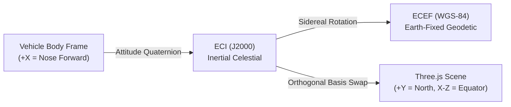

# Phase 10: Digital Engineering Spatial Dashboard — Coordinate Frame Conventions

## 1. Frame Definitions & Mathematical Standards

To guarantee physical integrity without ad-hoc sign flips, all spatial transforms between solvers and the Three.js WebGL engine adhere to strict coordinate frame transformations.

---

## 2. Formal Coordinate Frames

### 2.1 Earth-Centered Inertial (ECI / J2000)
- **Origin:** Center of mass of the Earth.
- **Fundamental Plane:** Earth's mean celestial equator at J2000.0.
- **$+X_{\text{ECI}}$:** Directed toward the First Point of Aries (Vernal Equinox $\Upsilon$).
- **$+Z_{\text{ECI}}$:** Directed along Earth's rotational spin axis (North Celestial Pole).
- **$+Y_{\text{ECI}}$:** Completes right-handed orthogonal system ($+Y = Z \times X$).
- **Usage:** Orbital propagation (Phase 5), ascent equations of motion (Phase 3).

### 2.2 Earth-Centered Earth-Fixed (ECEF / WGS-84)
- **Origin:** Center of mass of the Earth.
- **Rotation:** Rotates with Earth's sidereal angular velocity $\omega_\oplus = 7.2921150 \times 10^{-5}\,\text{rad/s}$.
- **$+X_{\text{ECEF}}$:** Intersection of Equator and Prime Meridian (Greenwich $0^\circ\text{E}$).
- **$+Z_{\text{ECEF}}$:** True Geographic North Pole.
- **$+Y_{\text{ECEF}}$:** Intersection of Equator and $90^\circ\text{E}$ longitude.
- **Usage:** Ground tracks, geodetic latitude/longitude, landing splashdown coordinates (Phases 6, 7).

### 2.3 Spacecraft Body Frame (B)
- **Origin:** Vehicle Center of Mass (CoM).
- **$+X_{\text{body}}$:** Longitudinal centerline directed forward toward the nose apex.
- **$+Y_{\text{body}}$:** Lateral axis directed toward starboard (right aerodynamic fin/flap).
- **$+Z_{\text{body}}$:** Normal axis directed toward the dorsal spine ($+Z$) / belly heat shield ($-Z$).
- **Usage:** Aerodynamic flap deflections, angle of attack ($\alpha$), sideslip ($\beta$), body rates ($p, q, r$).

### 2.4 Three.js WebGL Graphics World Frame
- **Standards:** Three.js uses a right-handed Cartesian coordinate system where:
  - **$+Y_{\text{scene}}$:** Directed "UP" along the screen / Earth North Pole.
  - **$+X_{\text{scene}}$:** Directed "RIGHT" along the equatorial plane.
  - **$+Z_{\text{scene}}$:** Directed "OUT OF THE SCREEN" toward the camera.

---

## 3. Transformation from Solver ECI to Three.js World

To align the celestial equator with the Three.js horizontal ground plane and the North Pole with $+Y_{\text{scene}}$, the exact transformation matrix is:

$$\begin{bmatrix} X_{\text{scene}} \\ Y_{\text{scene}} \\ Z_{\text{scene}} \end{bmatrix} = \begin{bmatrix} 1 & 0 & 0 \\ 0 & 0 & 1 \\ 0 & -1 & 0 \end{bmatrix} \begin{bmatrix} X_{\text{ECI}} \\ Y_{\text{ECI}} \\ Z_{\text{ECI}} \end{bmatrix}$$

$$\det(R_{\text{ECI}\to\text{Three}}) = (1)(0 - (-1)) = +1$$

> [!NOTE]
> Because $\det(R) = +1$ and $R^T R = I$, this transformation is a pure rigid-body rotation around the X-axis by $-90^\circ$. It strictly preserves handedness, chirality, distances, and angles.

---

## 4. Origin Rebasing & Float32 Precision Management

Three.js shaders utilize single-precision 32-bit floats (24 bits of mantissa), providing $\approx 7$ significant decimal digits.
At orbital distances ($r \approx 6.6 \times 10^6\,\text{m}$), spatial resolution degrades to $\approx 1\,\text{meter}$, creating visible vertex jitter on a $50\,\text{m}$ spacecraft.

**Solution: Camera-Relative Origin Rebasing:**
1. In the global mission overview mode, Earth and trajectory are rendered in normalized planetary units ($1\,\text{unit} = 1000\,\text{km}$).
2. In vehicle close-up mode, the spacecraft center of mass is locked at the local Three.js origin $(0, 0, 0)$, and background celestial bodies are offset relative to the vehicle position, guaranteeing sub-millimeter geometric rendering fidelity.
