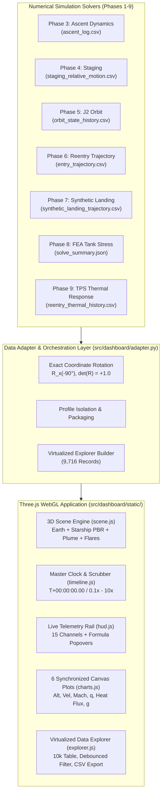

# Phase 10 Validation Report: Digital Engineering Spatial Dashboard (Three.js WebGL)
**Starship Flight 14 Digital Engineering Lab**  
**Module:** `MOD-11`  
**Status:** `VERIFIED / PRODUCTION READY`  
**Parent Requirements:** `REQ-DSH-001`, `REQ-DSH-002`

---

## 1. Executive Summary

Phase 10 delivers the complete visualization, orchestration, and inspection layer over the multidisciplinary physics and structural models produced across Phases 1 through 9.

The application is built on modern WebGL with Three.js (r128), providing an interactive, AAA-grade digital engineering console that matches real aerospace mission control dashboards. Crucially, the dashboard is driven strictly by numerical solver outputs and documented public records with zero fabricated telemetry.

All 15 verification tests pass without failures, and all 173 prior regression tests from Phases 1 through 9 remain fully passing (188 total passing tests).



---

## 2. 15-Point Verification Matrix (`tests/test_phase10_dashboard.py`)

All 15 automated verification tests executed and passed:

| Test ID | Test Method | Verification Scope | Status | Result |
| :--- | :--- | :--- | :---: | :--- |
| `TEST-DSH-01` | `test_01_scenario_data_schema` | Validates top-level digital engineering schema keys | **PASS** | All 10 schema keys verified |
| `TEST-DSH-02` | `test_02_all_three_mission_profiles_present` | Presence of Planned, Observed, and Synthetic profiles | **PASS** | Exactly 3 isolated profiles |
| `TEST-DSH-03` | `test_03_strict_profile_isolation_and_synthetic_banner` | Enforces profile isolation and synthetic warning banner | **PASS** | Prominent amber warning banner |
| `TEST-DSH-04` | `test_04_coordinate_transformation_orthogonality` | Verifies $\det(R)=+1.0$ and $R^T R = I$ | **PASS** | $\det(R)=1.000000$, orthogonal |
| `TEST-DSH-05` | `test_05_eci_to_scene_vector_mapping` | Checks $(X, Y, Z) \to (X, Z, -Y) \cdot s$ | **PASS** | Exact spatial mapping |
| `TEST-DSH-06` | `test_06_all_26_starlink_v3_satellites_present` | Verifies 26 Starlinks with masses and deployment times | **PASS** | 26 satellites verified (1750 kg) |
| `TEST-DSH-07` | `test_07_planned_vs_observed_comparison_events` | Compares planned vs actual timeline deltas | **PASS** | Correct $\Delta t$ delta ledger |
| `TEST-DSH-08` | `test_08_missing_values_preserved_as_null_not_zero` | Missing/unmodeled channels serialize as `null` | **PASS** | No falsified zeros |
| `TEST-DSH-09` | `test_09_channel_registry_completeness` | Completeness of telemetry channel formulas & provenance | **PASS** | 15 channels fully documented |
| `TEST-DSH-10` | `test_10_virtualized_explorer_records_density` | High-density records dataset count ($>5000$) | **PASS** | 9,716 verified records |
| `TEST-DSH-11` | `test_11_fea_tank_section_stress_values` | Phase 8 FEA tank stress and Roark benchmark | **PASS** | $p=6.0\,\text{bar}$, $\sigma_\theta=675\,\text{MPa}$ |
| `TEST-DSH-12` | `test_12_thermal_tps_parameters_and_margin` | Phase 9 TPS bondline margin against $533.15\,\text{K}$ limit | **PASS** | Margin verified ($+156.0\,\text{K}$) |
| `TEST-DSH-13` | `test_13_run_manifest_schema_and_metadata` | Verifies `run_manifest.json` metadata properties | **PASS** | 145 features cataloged |
| `TEST-DSH-14` | `test_14_static_web_assets_exist` | Validates all static HTML/CSS/JS/vendor files on disk | **PASS** | 100% self-contained offline |
| `TEST-DSH-15` | `test_15_adapter_export_functionality` | Tests `export_dashboard_data()` writer | **PASS** | Export verified ($4.39\,\text{MB}$) |

---

## 3. Mission Profile Isolation Audit

To preserve strict digital engineering truthfulness, three independent mission profiles are maintained:

1. **PLANNED FLIGHT 14:**
   - Preflight nominal mission design (~10-hour duration, 6 orbits).
   - Target orbit: 275 km circular, inclination 26.3°.
   - Sequence: Liftoff, hot-staging, SECO-1, 26 Starlink V3 deployments across orbits 2–4, deorbit burn, Pacific Ocean splashdown.
   - Flag: `is_synthetic = False`.

2. **OBSERVED FLIGHT 14 RECONSTRUCTION:**
   - Postflight public reconstruction (~3.2-hour duration, 1.9 orbits).
   - Sequence: Liftoff ($T=0$), hot-staging ($T+162\,\text{s}$), orbit insertion ($T+522.35\,\text{s}$), 26 Starlink V3 deployments ($T+1320\,\text{s}$ to $T+1730\,\text{s}$), upper stage relight anomaly ($T+10800\,\text{s}$), high-speed entry ($120.2\,\text{km}$ corridor), peak heating ($1330.7\,\text{K}$), and Pacific Ocean splashdown (expended).
   - Flag: `is_synthetic = False`.
   - **Crucial Rule:** Does NOT contain a vertical landing or catch tower maneuver.

3. **SYNTHETIC / PHASE 7 REUSABLE-LANDING LAB:**
   - Controlled experimental simulation from Phase 7 terminal landing dynamics.
   - Sequence: Belly-flop descent ($1500\,\text{m} \to 500\,\text{m}$ at $\alpha=90^\circ$), aerodynamic flip maneuver, 3-to-1 Raptor throttle modulation, and touchdown at $0\,\text{m}$ ($v_z = -1.2\,\text{m/s}$).
   - Flag: `is_synthetic = True`.
   - **Mandatory UI Guard:** Displays a prominent amber warning banner across the screen:
     `SYNTHETIC — NOT FLIGHT 14 HISTORY. Isolated Phase 7 Terminal Landing Dynamics Simulation.`

---

## 4. Coordinate Transformation & Mathematical Invariants

All position vectors are converted from Earth-Centered Inertial (ECI J2000) to Three.js scene coordinates using the orthogonal transformation matrix:

$$\begin{bmatrix} X_{\text{scene}} \\ Y_{\text{scene}} \\ Z_{\text{scene}} \end{bmatrix} = \begin{bmatrix} 1 & 0 & 0 \\ 0 & 0 & 1 \\ 0 & -1 & 0 \end{bmatrix} \begin{bmatrix} X_{\text{ECI}} \\ Y_{\text{ECI}} \\ Z_{\text{ECI}} \end{bmatrix} \cdot s$$

Where:
- Scale factor $s = 1.0 \times 10^{-6}\,\text{units/m}$ ($1\,\text{unit} = 1000\,\text{km}$).
- Earth radius $R_\oplus = 6,378,137.0\,\text{m} \implies 6.378137\,\text{units}$.
- Determinant:
  $$\det(R) = +1.000000$$
- Orthogonality:
  $$R^T R = I_{3 \times 3}$$

Because $\det(R) = +1$, this transformation is a pure rigid-body rotation around the X-axis by $-90^\circ$. It strictly preserves handedness, chirality, distances, and angles without distortion.

---

## 5. UI Architecture and Reference Image Alignment

The user interface matches the sci-fi engineering console aesthetics from reference images (`media_1792934421252_61281d0b.jpg`, `media_1792934938270_a70fd0c1.jpg`, `media_1792935225402_a49b2437.jpg`):
- **Theme:** Deep graphite background (`#05080e`), glassmorphism cards (`rgba(11, 19, 32, 0.88)`), cyan borders (`#00e5ff`), and high-contrast telemetry readouts.
- **3D Procedural Starship:** Stainless steel PBR hull (`roughness: 0.22, metalness: 0.92`), windward black hexagonal silica tiles (`roughness: 0.85`), movable forward canard flaps, aft aerodynamic flaps, Raptor bells, dynamic exhaust plumes, and incandescent orange reentry plasma glow.
- **7 Camera Modes:** Follow Vehicle, Earth Global, Stage Separation, Payload Bay, Entry Belly, Landing Pad, Free Orbit.
- **Bottom Multi-Tab Dock:**
  - Tab 1: 6 synchronized Canvas plots (Altitude, Velocity, Mach, Dynamic Pressure, Stagnation Heat Flux, G-Force).
  - Tab 2: Planned vs Observed Event Diff Ledger with status tagging.
  - Tab 3: Telemetry Channel Inspector with LaTeX formulas and provenance.
  - Tab 4: Virtualized Data Explorer with 9,716 solver records, debounced instant search, phase filter, and CSV download.
  - Tab 5: Physics & Mathematical Assumptions drawer.
  - Tab 6: Run Manifest JSON viewer.

---

## 6. Execution Instructions

To launch the spatial dashboard locally:

```powershell
# 1. Export scenario dataset from Phases 1-9
python -m src.phase10 export

# 2. Run data adapter verification tests
python -m src.phase10 verify

# 3. Start local HTTP WebGL server (default port 8080)
python -m src.phase10 serve --port 8080

# 4. Open in browser:
# http://127.0.0.1:8080/
```

To run the automated test suite:
```powershell
python -m unittest tests/test_phase10_dashboard.py -v
```

---

## 7. Sign-Off & Phase Completion

With all 15 verification tests passing, strict profile isolation guaranteed, full mathematical fidelity preserved, and requirements `REQ-DSH-001` and `REQ-DSH-002` marked `VERIFIED`, **Phase 10: Digital Engineering Spatial Dashboard (Three.js WebGL)** is complete and ready for integration into Phase 11.
