# Phase 11: Verification & Validation Master Plan
**Starship Flight 14 Digital Engineering Lab**  
**Standards Reference:** NASA-STD-7009B, NASA Systems Engineering Handbook App. D, NPR 7150.2D  
**Author:** Lead Independent Verification, Flight-Dynamics Validation & Software-Assurance Engineer

---

## 1. Scope & Objective

This Verification & Validation (V&V) plan establishes a rigorous, evidence-based methodology to evaluate the entire computational stack of the Starship Flight 14 Digital Engineering Lab (Phases 1 through 10).

The plan evaluates:
1. **Mathematical correctness:** Do equations implemented in Python correspond to classical aerospace mechanics and fluid dynamics?
2. **Numerical convergence:** Are integration errors, discretization errors, and step-size artifacts within quantifiable bounds?
3. **Data contract & interface integrity:** Do states, masses, coordinate frames, and timestamps pass across module boundaries without corruption?
4. **Empirical agreement:** How well do model predictions match independent numerical benchmarks (GMAT, Roark, Sutton-Graves) and public Flight 14 mission milestones?
5. **Uncertainty bounds:** What are the quantitative confidence intervals and parameter sensitivities across nominal and off-nominal mission scenarios?

---

## 2. Tiered Verification Architecture

```mermaid
flowchart TD
    subgraph L1["Level 1: Software Unit & Schema (Functions & Types)"]
        U1["Coordinate frame transformations & orthogonality"]
        U2["SI unit conversions & boundary checking"]
        U3["JSON / CSV schema validation & null-preservation"]
    end

    subgraph L2["Level 2: Numerical & Invariant Verification (Solvers)"]
        N1["Step-size & tolerance convergence studies"]
        N2["Conservative two-body energy & angular momentum drift"]
        N3["Mass depletion & Tsiolkovsky momentum balance"]
        N4["TDMA thermal energy conservation"]
    end

    subgraph L3["Level 3: Subsystem Integration (Coupled Physics)"]
        S1["Phase 3 Ascent -> Phase 4 Hot-Staging handoff"]
        S2["Phase 4 SECO -> Phase 5 J2 Orbit Insertion"]
        S3["Phase 5 Disposal Burn -> Phase 6 120km Entry Interface"]
        S4["Phase 6 Reentry State -> Phase 9 TPS Conduction"]
    end

    subgraph L4["Level 4: Cross-Solver Independent Benchmarks"]
        B1["NASA GMAT R2026a J2 Orbit Ephemeris Residuals"]
        B2["Roark Formulas for Stress & Strain (Tank Membrane)"]
        B3["Sutton-Graves vs DKR Stagnation Heat Flux"]
    end

    subgraph L5["Level 5: Mission Event Validation (Public Truth)"]
        E1["Liftoff, staging timing, and engine anomaly detection"]
        E2["26 Starlink V3 payload deployment count"]
        E3["Northern Pacific splashdown outcome (expended)"]
    end

    subgraph L6["Level 6: Uncertainty Quantification & Sensitivity"]
        Q1["Covariance & Jacobian first-order propagation"]
        Q2["Monte Carlo dispersion sampling & quantile convergence"]
        Q3["Sobol / Morris sensitivity influence rankings"]
    end

    L1 --> L2
    L2 --> L3
    L3 --> L4
    L4 --> L5
    L5 --> L6
```

---

## 3. The 10 Verification Suites

### Suite 1: Unit & Function Verification (`tests/test_analytical_benchmarks.py`, `tests/test_phase1_data_integrity.py`)
- Tests individual formulas, SI conversions, coordinate transforms, and schema validators.
- Acceptance criteria: 100% mathematical match to standard analytical formulas.

### Suite 2: Schema, Units, Frame & Event Acceptance (`tests/test_phase10_dashboard.py`)
- Verifies ECI to Three.js transformation matrix:
  $$X_{\text{scene}} = X_{\text{ECI}}, \quad Y_{\text{scene}} = Z_{\text{ECI}}, \quad Z_{\text{scene}} = -Y_{\text{ECI}}$$
  Checks $\det(R) = +1.0$, $R^T R = I$.
- Missing values preserved strictly as `null`, never falsified to zero.

### Suite 3: Numerical Solver Verification (`tests/test_phase3_acceptance.py`, `tests/test_phase5_astrodynamics.py`)
- Tests RK4 fixed-step and Dormand-Prince adaptive integrators.
- Verifies two-body specific energy drift $|\Delta \varepsilon / \varepsilon_0| < 10^{-6}$ over 3 orbits.

### Suite 4: Solver Boundary & Interface Tests (`tests/test_phase4_staging_recovery.py`, `tests/test_phase6_reentry.py`)
- Verifies state handoff at staging ($T+154\,\text{s}$), SECO ($T+522.35\,\text{s}$), and entry interface ($120.0\,\text{km}$, $t=6024.96\,\text{s}$).
- Discontinuity check: Position jump $< 1\,\text{m}$, velocity jump $< 0.01\,\text{m/s}$.

### Suite 5: Subsystem Integration Tests (`src/run_mission_pipeline.py`)
- End-to-end integration across ascent, staging, orbit, payload release, disposal burn, and reentry.
- Mass conservation: $m_{\text{initial}} - \Delta m_{\text{prop}} - \Delta m_{\text{payload}} = m_{\text{final}}$ within $0.01\,\text{kg}$.

### Suite 6: End-to-End Mission Pipeline Tests (`tests/test_mass_balance.py`)
- Verifies full mission timeline from $T-0$ to ocean splashdown.
- Ensures all output files (`ascent_log.csv`, `orbit_state_history.csv`, `entry_trajectory.csv`) are generated and consistent.

### Suite 7: Independent Reference Benchmarks (`tests/test_phase5_astrodynamics.py`, `tests/test_phase8_fea.py`, `tests/test_phase9_thermal.py`)
- NASA GMAT R2026a comparison: Semi-major axis residual $< 0.1\%$, eccentricity residual $< 0.001$.
- Roark's Stress & Strain comparison: Hoop stress residual $< 0.01\%$ ($\sigma_\theta = 675.0\,\text{MPa}$).
- Detra-Kemp-Riddell vs Sutton-Graves flux: $q_{\text{DKR}} / q_{\text{SG}} = 0.7075 \pm 0.001$.

### Suite 8: Public Flight 14 Event-Level Validation (`tests/test_phase1_data_integrity.py`, `tests/test_phase10_dashboard.py`)
- Compares simulated milestones against public reporting ledger (`data/phase11/flight14_events.json`).
- Asserts orbital insertion at ~275 km, 26 Starlinks deployed, and Northern Pacific splashdown.

### Suite 9: Regression, Performance & Reproducibility Tests (`tests/`)
- Full test suite must pass 188/188 tests in $< 250\,\text{s}$.
- Deterministic random seed reproducibility: Seed 42 produces identical hashes across runs.

### Suite 10: UQ Distribution, Sampling & Sensitivity Tests (`tests/test_phase11_verification.py`)
- Monte Carlo dispersion convergence: Mean and 95th percentile stabilize within $1.5\%$ over successive batches.
- Input distribution validity: Covariance matrices are symmetric and positive semidefinite.
- Parameter sensitivity influence ranking: Morris/Sobol screening identifies dominant drivers.

---

## 4. Acceptance Criteria & Credibility Gates

| Gate ID | Verification Item | Predefined Tolerance / Criterion | Verification Method | Pass / Fail Rule |
| :--- | :--- | :--- | :--- | :--- |
| `GATE-01` | Mathematical Invariants | Energy drift $< 10^{-6}$, angular momentum drift $< 10^{-6}$ | Conservation analysis | Auto-fails if drift exceeds $10^{-5}$ |
| `GATE-02` | State Interface Continuity | $\Delta r < 1.0\,\text{m}$, $\Delta v < 0.01\,\text{m/s}$ across handoffs | Interface inspection | Auto-fails on discontinuous state leap |
| `GATE-03` | NASA GMAT Benchmark | SMA relative diff $< 0.1\%$, ecc diff $< 0.001$ | Independent code execution | Auto-fails if GMAT ephemeris diverts |
| `GATE-04` | Roark FEA Benchmark | Hoop stress relative error $< 0.5\%$ | Closed-form formula match | Auto-fails if FEA hoop stress differs $> 1\%$ |
| `GATE-05` | Mission Truth Alignment | 26 satellites, ~275 km orbit, Pacific splashdown | Public ledger comparison | Auto-fails if landing recovery is claimed |
| `GATE-06` | UQ Convergence | Median and 95th percentile converge within $2.0\%$ | Batch quantile comparison | Auto-fails if sample count is under-resolved |
| `GATE-07` | Full Suite Regression | 100% test pass rate across all test files | Test discovery execution | Auto-fails on any test failure |
