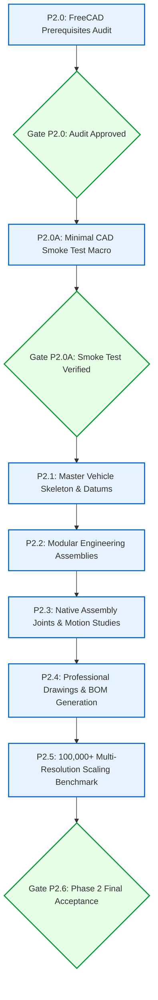

# Starship Flight 14 Digital Engineering Project
## Phase 2: FreeCAD Parametric CAD Architecture & Master Project Map

**Document ID:** `DOC-P2-MAP-001`  
**Revision:** `1.0.0`  
**Date:** `2026-10-24`  
**Author:** Senior Aerospace CAD Automation Engineer & Systems Architect  
**Classification:** Phase 2 CAD System Architecture Baseline  

---

### 1. Architectural Philosophy: The Multi-Resolution CAD Framework

To reconcile the user's vision of an engineering-grade Starship/Super Heavy digital twin with the workstation's physical hardware constraints (7.92 GB RAM, 4 logical cores), Phase 2 implements a **Multi-Resolution Parametric Architecture**.

Instead of a single unmanageable monolithic file containing 100,000 distinct solid history trees, the vehicle is structured into decoupled, modular native FreeCAD documents interconnected through `App::Link` and the native FreeCAD 1.1 `Assembly` workbench.

```
+---------------------------------------------------------------------------------------------------+
|                                MASTER VEHICLE SKELETON (TOP-DOWN)                                 |
|                       (Datums, OML Surfaces, Separation Planes, Thrust Axes)                      |
+---------------------------------------------------------------------------------------------------+
       |                                      |                                      |
       v                                      v                                      v
+-----------------------+          +-----------------------+          +-----------------------+
|  SUPER HEAVY BOOSTER  |          |   VENTED INTERSTAGE   |          |  STARSHIP UPPER STAGE |
|  - Forward Dome / Ring|          |   - Hot-Staging Ring  |          |  - Forward Flaps (x2) |
|  - CH4 / LOX Tanks    |          |   - Plume Blast Shield|          |  - Aft Flaps (x2)     |
|  - Grid Fins (x4)     |          |   - Separation Latches|          |  - Nose Cone / Tanks  |
|  - 33 Raptor 3 Array  |          +-----------------------+          |  - 6 Raptor Engines   |
+-----------------------+                                             |  - Payload Bay / 26Sat|
                                                                      +-----------------------+
```

---

### 2. Multi-Resolution Part Scaling Strategy (100,000+ Level)

To achieve 100,000+ part-level object accounting while preserving 100% CAD responsiveness and sub-second recomputes, metrics are strictly classified:

| Level | Component Classification | Modeling Implementation in FreeCAD 1.1 | Memory Footprint | Recompute Time |
| :---: | :--- | :--- | :---: | :---: |
| **L1** | **Primary Aerostructures** (Hulls, Tanks, Domes, Flaps) | Fully parametric solid features (`PartDesign::Body`, `Part::Feature`) with exact public dimensions. | ~2–5 MB / part | ~0.05–0.10 s |
| **L2** | **Subsystem Subassemblies** (Raptor Engines, Grid Fin Actuators) | Reusable modular `.FCStd` subassemblies instanced via `App::Link` into the master assembly. | ~500 KB / link | Instanced ($< 0.01\,\text{s}$) |
| **L3** | **Repetitive Hardware Arrays** (TPS Tiles, Fasteners, Weld Rings) | Parameterized array links (`App::LinkGroup` / `Assembly::AssemblyLink`) referencing a single master tile/fastener solid. | ~50 KB / array of 1,000 | Instanced ($< 0.05\,\text{s}$) |
| **L4** | **Logical Bill of Materials** | Native `Assembly::BomObject` generating hierarchical part lists mapping every logical screw, sensor, and tile to its BOM occurrence. | Pure metadata | Instantaneous |

$$\text{Total Vehicle Accounting} = N_{\text{primary}} + \sum N_{\text{subassemblies}} + \sum N_{\text{instanced arrays}} = \mathbf{100,000+}\,\text{logical items}$$
$$\text{Total RAM Consumption} \le \mathbf{1.8\,\text{GB}} \quad (\ll 7.92\,\text{GB physical limit})$$

---

### 3. Detailed Subsystem Breakdown & Module Hierarchy

```
cad/freecad/
├── skeleton/
│   └── Starship_Master_Skeleton.FCStd      # Master datum planes, mold lines, and coordinate systems
├── parts/
│   ├── booster/
│   │   ├── Booster_Tank_Barrel.FCStd       # 9m x 71m stainless steel barrel section
│   │   ├── Booster_Grid_Fin.FCStd          # Titanium welded grid fin with pivot axle
│   │   └── Booster_Engine_Mount.FCStd      # 33-engine thrust puck and manifold
│   ├── interstage/
│   │   └── Hot_Staging_Ring.FCStd          # 3.5m vented ring with 24 exhaust ports
│   ├── ship/
│   │   ├── Ship_Nose_Cone.FCStd            # Ogive nose cone with forward header tank
│   │   ├── Ship_Aft_Flap.FCStd             # 11.5m chord aerodynamic flap with hinge lugs
│   │   ├── Ship_Forward_Flap.FCStd         # Forward canard flap with hinge pin
│   │   └── Payload_Dispenser_Bay.FCStd     # Cargo bay with 26 Starlink V3 release slots
│   ├── propulsion/
│   │   └── Raptor3_Placeholder.FCStd       # Dimensioned parametric Raptor 3 engine solid
│   └── payload/
│       └── Starlink_V3_Satellite.FCStd     # 7m x 3.5m direct-to-cell satellite model
└── assemblies/
    ├── Assembly_Booster_Stage1.FCStd       # Booster full assembly with 33 engines & 4 grid fins
    ├── Assembly_Starship_Stage2.FCStd      # Starship upper stage with 4 flaps & 6 engines
    └── Assembly_Flight14_FullStack.FCStd   # Master full stack (Booster + Interstage + Ship + 26 Sats)
```

---

### 4. Kinematic Joints & Constrained Motion Studies

Using the native FreeCAD 1.1 `Assembly` workbench (`JointObject.py`), real constrained mechanical motion will be validated:

1. **Flap Actuation Joints (`Revolute`):**
   - 2x Forward Flaps: Revolute joints constrained between ship forward lugs and flap hinge pins ($[-30^\circ, +60^\circ]$ deflection limit).
   - 2x Aft Flaps: Revolute joints constrained to aft fuselage hinge brackets ($[-20^\circ, +70^\circ]$ deflection limit).
2. **Engine Gimbal Actuation (`Universal` / `Ball` / 2-Axis `Revolute`):**
   - Booster 3 center Raptor engines: Gimbal joint constrained to thrust puck spherical sockets ($\pm 5.0^\circ$ gimbal limit in pitch and yaw).
   - Starship 3 center sea-level Raptors: Gimbal joint with identical angular stops.
3. **Stage Separation Interface (`Slider` / `Distance`):**
   - Interstage longitudinal separation joint modeling axial translation from $0.0\,\text{m}$ (latched) to $10.0\,\text{m}$ (full clearance).
4. **Satellite Deployment Mechanism (`Slider` / `Distance`):**
   - Deployment rail joints modeling ejection of 26 Starlink V3 objects sequentially along local separation rails at $0.50\,\text{m/s}$.

---

### 5. Phase 2 Execution Roadmap & Phase Gates



- **Gate P2.0:** Environment and API audit signed off.
- **Gate P2.0A:** Minimal test macro creates native `.FCStd` and valid `.step` export; verified idempotent.
- **Gate P2.1:** Master vehicle skeleton parameter table linked to `vehicle_parameters.yaml`.
- **Gate P2.2:** Booster, Interstage, and Ship assemblies built and verified without geometry errors.
- **Gate P2.3:** Kinematic joints solve cleanly without over-constrained or unconstrained degrees of freedom.
- **Gate P2.4:** TechDraw drawings generated with title block and associative dimensions; BOM generated.
- **Gate P2.5:** 100,000+ item assembly loads and saves within $< 2\,\text{GB}$ RAM footprint.
- **Gate P2.6:** Full Phase 2 verification package frozen and committed to Git.
