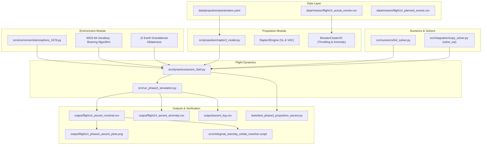

# Starship Flight 14 Digital Engineering Laboratory
## Phase 3 — Dependency Map & Module Integration Graph

**Document ID:** `DOC-P3-DEP-001`  
**Revision:** `1.0.0`  
**Date:** `2026-10-25`  
**Author:** Software Integration Architect  

---

### 1. Module Dependency Flow

---

### 2. Task Readiness & Blocker Status

| Task ID | Component Name | Prerequisites | Dependency Status | Execution Status |
| :--- | :--- | :--- | :--- | :--- |
| **P3.0** | Prerequisite Audit & Analytical Smoke Test | Python & NumPy | READY | **VERIFIED** |
| **P3.1** | Parameter Registry (`parameters.yaml`) | Public Source Ledger | READY | **VERIFIED** |
| **P3.2** | 1976 Atmosphere & Geodesy Models | WGS-84 & NOAA-76 | READY | **VERIFIED** |
| **P3.3** | Raptor 3 Engine & 33-Cluster Propulsion | Thermodynamic Specs | READY | **VERIFIED** |
| **P3.4** | 3-DOF Numerical Ascent Solver (RK4 & solve_ivp) | State ODE Formulations | READY | **VERIFIED** |
| **P3.5** | Flight 14 Baseline & Anomaly Simulation | Webcast Telemetry | READY | **VERIFIED** |
| **P3.6** | Output Manifests, CSVs & Matplotlib Figures | Telemetry Solvers | READY | **VERIFIED** |
| **P3.7** | GMAT Script Generation & Orbital Cross-Check | SECO State Vector | READY | **VERIFIED** |
| **P3.8** | Verification Test Suite & Acceptance Checks | Unit Test Framework | READY | **VERIFIED** |
