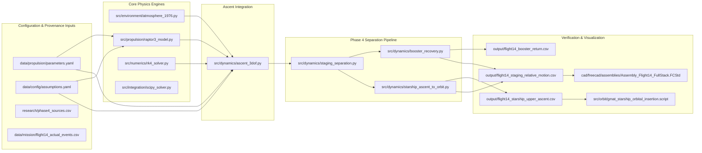

# Phase 4 Dependency Map & Data Pipeline Flow

**Document ID:** `DOC-P4-DEP-001`  
**Classification:** Dependency Mapping & Interface Contract  
**Revision:** 1.0  
**Lead:** Software Integration Architect  

---

## 1. Upstream & Downstream Interfaces

Phase 4 couples upstream aerodynamic, atmospheric, and propulsion models to downstream multi-body relative motion dynamics, orbital propagation, and CAD visualization.

---

## 2. File and Module Dependency Table

| Module / Script | File Path | Direct Dependencies | Consumed By | Verification Test |
| :--- | :--- | :--- | :--- | :--- |
| **Atmospheric Model** | `src/environment/atmosphere_1976.py` | Python `math` | `ascent_3dof.py`, `booster_recovery.py` | `test_phase3_propulsion_ascent.py` |
| **Raptor 3 Model** | `src/propulsion/raptor3_model.py` | `atmosphere_1976.py` | `ascent_3dof.py`, `starship_ascent_to_orbit.py` | `test_phase3_propulsion_ascent.py` |
| **RK4 Solver** | `src/numerics/rk4_solver.py` | Python `math` | `ascent_3dof.py`, `booster_recovery.py` | `test_phase3_acceptance.py` |
| **Ascent Core** | `src/dynamics/ascent_3dof.py` | `raptor3_model.py`, `rk4_solver.py` | `staging_separation.py` | `test_phase3_acceptance.py` |
| **Staging Separation**| `src/dynamics/staging_separation.py` | `ascent_3dof.py`, `booster_recovery.py`, `starship_ascent_to_orbit.py` | `src/run_phase4_staging.py` | `test_phase4_staging_recovery.py` |
| **Booster Recovery** | `src/dynamics/booster_recovery.py` | `atmosphere_1976.py`, `rk4_solver.py` | `staging_separation.py` | `test_phase4_staging_recovery.py` |
| **Starship Orbit** | `src/dynamics/starship_ascent_to_orbit.py` | `raptor3_model.py`, `rk4_solver.py` | `staging_separation.py` | `test_phase4_staging_recovery.py` |
| **GMAT Orbit Script**| `src/orbit/gmat_starship_orbital_insertion.script`| `flight14_starship_upper_ascent.csv` | NASA GMAT Console R2026a | GMAT execution test |
