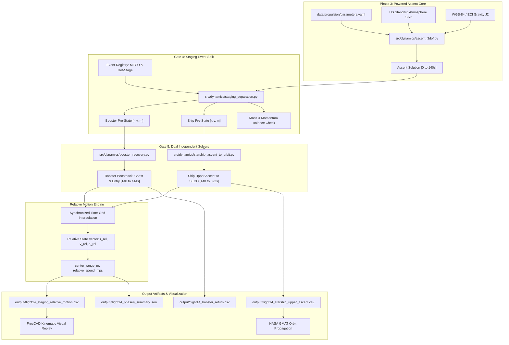

# Phase 4 Model Architecture: Modular Staging Dynamics Pipeline

**Document ID:** `DOC-P4-ARCH-001`  
**Classification:** System Software & Computational Architecture  
**Revision:** 1.0  
**Lead:** Software Architecture & Numerical Systems Lead  

---

## 1. System Pipeline Architecture

The Phase 4 architecture cleanly separates the continuous single-stack ascent trajectory from the multi-body event execution, independent numerical propagation, and metric synthesis.

---

## 2. Mathematical Equations of Motion

For each stage $i \in \{\text{booster}, \text{ship}\}$ after separation ($t \ge T_{\text{stage}}$):

$$\frac{d\mathbf{r}_i}{dt} = \mathbf{v}_i$$

$$\frac{d\mathbf{v}_i}{dt} = \mathbf{g}(\mathbf{r}_i) + \frac{\mathbf{F}_{\text{thrust}, i}(t) + \mathbf{F}_{\text{aero}, i}(\mathbf{r}_i, \mathbf{v}_i) + \mathbf{F}_{\text{external}, i}(t)}{m_i(t)}$$

$$\frac{dm_i}{dt} = -\dot{m}_{\text{prop}, i}(t)$$

### Gravitational Field Model:
$$\mathbf{g}(\mathbf{r}) = -\frac{\mu}{\|\mathbf{r}\|^3} \mathbf{r} + \mathbf{a}_{J_2}(\mathbf{r})$$
where:
$$\mathbf{a}_{J_2}(\mathbf{r}) = -\frac{3}{2} J_2 \frac{\mu R_E^2}{\|\mathbf{r}\|^5} \begin{bmatrix} x \left(1 - 5 \frac{z^2}{\|\mathbf{r}\|^2}\right) \\ y \left(1 - 5 \frac{z^2}{\|\mathbf{r}\|^2}\right) \\ z \left(3 - 5 \frac{z^2}{\|\mathbf{r}\|^2}\right) \end{bmatrix}$$

### Aerodynamic Force Model:
$$\mathbf{F}_{\text{aero}, i} = -\frac{1}{2} \rho(h) \|\mathbf{v}_{\text{rel}, i}\| \mathbf{v}_{\text{rel}, i} S_{\text{ref}, i} C_{D, i}(M_i)$$
where relative velocity accounts for Earth rotation:
$$\mathbf{v}_{\text{rel}, i} = \mathbf{v}_i - \boldsymbol{\omega}_E \times \mathbf{r}_i$$

---

## 3. Relative Motion Engine

To ensure mathematical rigor, relative quantities are computed on a synchronized, uniform 100 Hz output time grid ($t_k = 140.0 + k \times 0.01\,\text{s}$):

$$\mathbf{r}_{\text{rel}}(t_k) = \mathbf{r}_{\text{ship}}(t_k) - \mathbf{r}_{\text{booster}}(t_k)$$
$$\mathbf{v}_{\text{rel}}(t_k) = \mathbf{v}_{\text{ship}}(t_k) - \mathbf{v}_{\text{booster}}(t_k)$$
$$\text{center\_range\_m}(t_k) = \|\mathbf{r}_{\text{rel}}(t_k)\|$$
$$\text{relative\_speed\_mps}(t_k) = \|\mathbf{v}_{\text{rel}}(t_k)\|$$

Any missing values or out-of-bounds queries must be bounded: extrapolation outside each vehicle's valid integration span is strictly prohibited.
