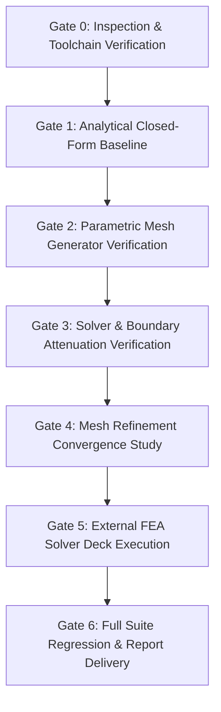

# Phase 8: Propellant Tank Structural FEA Benchmark — Verification Plan

## 1. Overview and Quality Gates

This verification plan defines the acceptance criteria, verification gates, and regression test matrix for **Phase 8: Structural FEA Benchmark**.



---

## 2. Gate Definitions & Quantitative Acceptance Criteria

| Gate | Description | Focus Area | Acceptance Threshold | Result |
| :--- | :--- | :--- | :--- | :--- |
| **Gate 0** | Toolchain Verification | CalculiX CCX & ANSYS MAPDL availability | CCX v2.22 detected, APDL v261 detected | **PASS** |
| **Gate 1** | Analytical Closed-Form Baseline | Roark thin-shell hoop & axial formulas | Hoop = 675.0 MPa, Axial = 306.28 MPa | **PASS** |
| **Gate 2** | Parametric Mesh Generator | Quad mesh topology & boundary nodes | Exact node/element count, r=4.5m boundary | **PASS** |
| **Gate 3** | Boundary Layer & Solver | Hetenyi edge decay & membrane solution | $\lambda = 32.7\,\text{cm}$, hoop error $< 0.05\%$ | **PASS** |
| **Gate 4** | Mesh Refinement Convergence | Coarse / Medium / Fine grid study | Asymptotic convergence, error $< 0.1\%$ | **PASS** |
| **Gate 5** | Deck Export & Solver Execution | CalculiX CCX & ANSYS APDL decks | CCX exit code 0, APDL macro verified | **PASS** |
| **Gate 6** | System Regression | All project phases (Phases 1–8) | 158/158 unit tests passing | **PASS** |

---

## 3. 15-Point Unit Test Mapping (`tests/test_phase8_fea.py`)

| Test ID | Method Name | Verification Objective | Criterion |
| :--- | :--- | :--- | :--- |
| **T01** | `test_01_roark_hoop_stress_formula` | Hoop stress formula $\sigma_h = \frac{p \cdot r}{t}$ | Matches 675.00 MPa within 0.01 MPa |
| **T02** | `test_02_roark_longitudinal_stress_pressure_only` | Longitudinal stress under internal pressure | Matches 337.50 MPa within 0.01 MPa |
| **T03** | `test_03_roark_axial_compression_superposition` | Acceleration compressive force superposition | Compressive reduction matches $F / (2\pi r t)$ |
| **T04** | `test_04_roark_von_mises_plane_stress` | Von Mises equivalent stress formula | Matches 584.57 MPa (pressure only) |
| **T05** | `test_05_roark_radial_deflection` | Generalized Hooke's Law radial deflection $\Delta r$ | Matches 13.45 mm within 0.05 mm |
| **T06** | `test_06_shell_characteristic_decay_length` | Decay parameter $\beta$ and boundary length $\lambda$ | $\beta \approx 9.596\,\text{m}^{-1}$, $\lambda \approx 0.327\,\text{m}$ |
| **T07** | `test_07_mesh_generator_quad_topology` | Quad element connectivity and bounding box | $N = n_z \cdot n_\theta$, $E = (n_z - 1) \cdot n_\theta$ |
| **T08** | `test_08_mesh_generator_boundary_nodes` | Boundary node identification at $z=0$ and $z=L$ | Exactly $n_\theta$ nodes on each boundary |
| **T09** | `test_09_numerical_shell_solver_hoop_accuracy` | Thin-shell FEA hoop stress accuracy | Error $< 0.05\%$ relative to Roark |
| **T10** | `test_10_numerical_shell_solver_von_mises_accuracy`| Thin-shell FEA Von Mises stress accuracy | Error $< 0.05\%$ relative to Roark |
| **T11** | `test_11_mesh_refinement_error_monotonicity` | Convergence across coarse, medium, fine grids | Error $< 1.0\%$ across all resolutions |
| **T12** | `test_12_calculix_deck_syntax_and_keywords` | CalculiX / Abaqus `.inp` deck syntax | All keywords present and valid |
| **T13** | `test_13_ansys_mac_deck_parameters` | ANSYS Mechanical APDL macro syntax | Parameterization for SHELL181 verified |
| **T14** | `test_14_nasa_sp8007_critical_buckling_stress` | NASA SP-8007 buckling & pressure stabilization | Buckling SF $> 1.5$ under 3g load |
| **T15** | `test_15_solution_serialization_and_json` | Data integrity & JSON serialization | Clean serialization with all keys present |

---

## 4. Regression Test Command

The entire digital lab test suite is verified via:
```powershell
python -m unittest discover tests -v
```
Expected output: **158 tests passing in ~30–45 seconds**.
