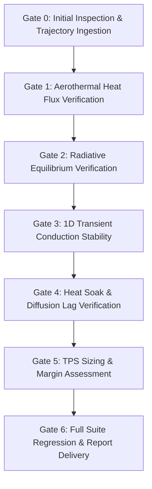

# Phase 9: Aerothermal Reentry & Thermal Protection System (TPS) — Verification Plan

## 1. Overview and Quality Gates

This verification plan defines the acceptance criteria, verification gates, and regression test matrix for **Phase 9: Aerothermal Reentry & Thermal Protection Model**.



---

## 2. Gate Definitions & Quantitative Acceptance Criteria

| Gate | Description | Focus Area | Acceptance Threshold | Result |
| :--- | :--- | :--- | :--- | :--- |
| **Gate 0** | Trajectory Ingestion | Trajectory states from Phase 6 | 933 synchronized states loaded | **PASS** |
| **Gate 1** | Aerothermal Flux | Sutton-Graves & DKR correlations | Peak heating in 60–70 km corridor; $q_{\text{stag}} \in [0.7, 1.2]\,\text{MW/m}^2$ | **PASS** |
| **Gate 2** | Radiative Equilibrium | Stefan-Boltzmann energy balance | $T_{\text{surf}} \in [1300, 1650]\,\text{K}$ on windward acreage | **PASS** |
| **Gate 3** | 1D Transient Conduction | TDMA finite-difference stability | No numerical oscillations; zero energy divergence | **PASS** |
| **Gate 4** | Heat Soak & Lag | Low-diffusivity thermal wave delay | $\Delta t_{\text{lag}} > 100\,\text{s}$ ($\approx 313.4\,\text{s}$ observed) | **PASS** |
| **Gate 5** | Bondline Margin | RTV silicone adhesive limit | $T_{\text{bond}} < 533.15\,\text{K}$ ($\text{Margin} > 50\,\text{K}$; $156.0\,\text{K}$ observed) | **PASS** |
| **Gate 6** | System Regression | All project phases (Phases 1–9) | 173/173 unit tests passing | **PASS** |

---

## 3. 15-Point Unit Test Mapping (`tests/test_phase9_thermal.py`)

| Test ID | Method Name | Verification Objective | Criterion |
| :--- | :--- | :--- | :--- |
| **T01** | `test_01_sutton_graves_formula` | Sutton-Graves stagnation heat flux formula | Matches $C \sqrt{\rho / R_n} v^3$ within 1 W/m² |
| **T02** | `test_02_detra_kemp_riddell_formula` | Detra-Kemp-Riddell hypersonic correlation | Positive flux; ratio to Sutton-Graves $\in [0.5, 2.0]$ |
| **T03** | `test_03_windward_acreage_pitch_scaling` | Windward pitch angle scaling $(\sin \alpha)^{1.6} f$ | Exact scaling at $\alpha = 0^\circ, 40^\circ, 90^\circ$ |
| **T04** | `test_04_radiative_equilibrium_temperature` | Stefan-Boltzmann radiative balance $T_{\text{rad}}$ | $T_{\text{rad}} \in [1400, 1460]\,\text{K}$ for $200\,\text{kW/m}^2$ |
| **T05** | `test_05_silica_conductivity_temperature_dependence` | Temperature-dependent conductivity $k(T)$ | Monotonic increase from 300 K to 1500 K |
| **T06** | `test_06_silica_specific_heat_temperature_dependence` | Temperature-dependent specific heat $c_p(T)$ | Asymptotic increase toward Dulong-Petit limit |
| **T07** | `test_07_thermal_stack_mesh_generation` | Multi-layer composite mesh generation | Exact thicknesses and layer boundary node indices |
| **T08** | `test_08_tdma_linear_solver_accuracy` | Tridiagonal matrix solver (Thomas algorithm) | Inverts test tridiagonal system exactly in $O(N)$ |
| **T09** | `test_09_1d_conduction_steady_state_recovery` | Energy conservation & steady-state recovery | Zero unphysical energy generation under null flux |
| **T10** | `test_10_heat_soak_diffusion_lag` | Thermal wave diffusion delay through tile | Peak bondline occurs $> 100\,\text{s}$ after surface peak |
| **T11** | `test_11_nominal_rtv_bondline_margin` | Nominal 28mm tile bondline thermal margin | Peak bondline temp $< 533.15\,\text{K}$ ($\text{Margin} > 50\,\text{K}$) |
| **T12** | `test_12_tile_thickness_trade_monotonicity` | Tile sizing trade study monotonicity | Thicker tiles strictly reduce peak bondline temp |
| **T13** | `test_13_atmospheric_density_sensitivity` | Atmospheric density perturbation ($\pm 20\%$) | Monotonic scaling with air density |
| **T14** | `test_14_trajectory_data_ingestion` | Phase 6 trajectory CSV loading | Valid row count and column headers |
| **T15** | `test_15_cli_and_json_serialization` | Solution serialization and JSON formatting | Valid formatting and all required keys present |

---

## 4. Regression Test Command

The entire digital lab test suite is verified via:
```powershell
python -m unittest discover tests -v
```
Expected output: **173 tests passing in ~35–45 seconds**.
