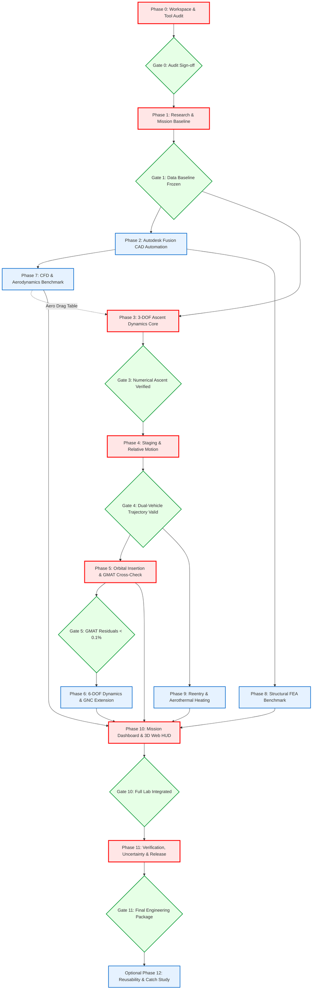

# Starship Flight 14 Digital Engineering Project
## Master System Architecture and Dependency Project Map

**Document ID:** `DOC-MAP-001`  
**Revision:** `1.0.0`  
**Date:** `2026-10-24`  
**Author:** Senior Aerospace Systems Engineering Lead & Simulation Architect  
**Classification:** Engineering Architecture Baseline  

---

### 1. System Vision & Architecture Overview

The **Starship Flight 14 Digital Engineering Laboratory** is an integrated, multidisciplinary aerospace simulation environment designed to reconstruct the publicly documented engineering aspects of SpaceX's Starship Flight 14 (September 28, 2026).

The system rejects superficial animations and fabricated telemetry. Every displayed state vector, aerodynamic coefficient, structural stress value, and thermal estimate originates from traceable mathematical equations, open-source physics solvers, or authoritative public flight observations.

```
+---------------------------------------------------------------------------------------------------+
|                                  ANTIGRAVITY ORCHESTRATION LAYER                                  |
|         (Build Automation, Solver Invocation, Evidence Verification, Schema Validation)          |
+---------------------------------------------------------------------------------------------------+
       |                                      |                                      |
       v                                      v                                      v
+-----------------------+          +-----------------------+          +-----------------------+
| RESEARCH & DATA LAYER |          |   PHYSICS & SOLVERS   |          | VISUALIZATION & UI    |
| - Source Library      |          | - Fusion 360 CAD API  |          | - Three.js WebGL HUD  |
| - Parameter Registry  |          | - Python 3-DOF / 6-DOF|          | - Telemetry Charts    |
| - Event Chronology    |          | - GMAT Orbital Engine |          | - Mission Event Replay|
| - Planned vs Actual   |          | - OpenFOAM / Fluent   |          | - Scenario Comparator |
+-----------------------+          | - ANSYS Mechanical    |          +-----------------------+
                                   +-----------------------+
```

---

### 2. Engineering Modules & System Responsibilities

The system is partitioned into 12 dedicated, decoupled engineering modules:

| Module ID | Module Name | Primary Responsibility | Assigned Tool / Solver | Primary Inputs | Primary Outputs |
| :--- | :--- | :--- | :--- | :--- | :--- |
| **MOD-01** | **System Orchestrator** | Coordinates execution, enforces phase gates, runs regression suites, checks data schemas. | Antigravity / Python / PowerShell | Project Map, Phase Configs | Run manifests, audit logs, test summaries |
| **MOD-02** | **Research & Evidence** | Ingests, hashes, citations, and indexes public data; preserves planned vs flown profiles. | Python (`pymupdf`, `pyyaml`) | Official SpaceX updates, FAA filings, news reports | `sources.csv`, `flight14_events.csv`, parameter ledger |
| **MOD-03** | **Parametric CAD** | Generates editable, parametric 3D geometry of Booster, Ship, Interstage, and Satellites. | Autodesk Fusion 360 Python API | Dimensional specs (heights, diameters, chords) | Native Fusion model, neutral STEP/STL exports |
| **MOD-04** | **Ascent Dynamics (3-DOF)**| Numerically solves translational equations of motion ($m \ddot{\mathbf{r}} = \mathbf{T} + \mathbf{D} + m\mathbf{g}$). | Python (`numpy`, RK4) / MATLAB | Mass properties, thrust curves, aero drag table | Trajectory CSV (pos, vel, acc, mass, dynamic pressure) |
| **MOD-05** | **Staging & Separation** | Models hot-staging separation dynamics, booster flip, boostback burn, and dual trajectory. | Python / MATLAB | Staging timing, relative velocity, plume blast | Separate state vectors for Booster & Ship |
| **MOD-06** | **Orbital & Deployment**| Propagates Keplerian & perturbed orbits, models sequential deployment of 26 Starlink V3 sats. | NASA GMAT R2026a (`gmatpy`) | Insertion state vector, deployment $\Delta v$ | Orbital elements ($a, e, i, \Omega, \omega, \nu$), satellite ephemerides |
| **MOD-07** | **6-DOF Dynamics & GNC** | Solves attitude kinematics (quaternions), aerodynamic moments, TVC actuation, and PEG guidance. | Python / MATLAB R2026a | Vehicle inertia tensor, TVC limits, guidance targets | Quaternion attitude history, body rates, control deflections |
| **MOD-08** | **Aerodynamics & CFD** | Computes lift, drag, and moment coefficients ($C_D, C_L, C_m$) across subsonic to hypersonic regimes. | OpenFOAM v2012 / ANSYS Fluent | Surface geometry (STEP/STL), freestream Mach, $\alpha$ | Pressure contours, force coefficients vs. Mach |
| **MOD-09** | **Structural FEA** | Analyzes launch & max-Q structural stress, interstage load transfer, and tank hoop stresses. | ANSYS Mechanical APDL / Fusion FEA | Structural geometry, tank pressure, axial load | Von Mises stress, displacement fields, safety factors |
| **MOD-10** | **Aerothermal Reentry** | Estimates stagnation point heat-flux, surface heating, and 1D thermal response during entry. | Python Thermal Model | Entry trajectory (altitude, velocity), TPS properties | Heat-flux histories ($q(t)$), surface temperature ($T_w(t)$) |
| **MOD-11** | **Mission Telemetry HUD**| Renders interactive 3D vehicle, orbital tracks, real-time telemetry plots, and event playback. | WebGL / Three.js / HTML5 | Trajectory CSVs, event logs, solver outputs | Web UI with playback controls, parameter inspector |
| **MOD-12** | **V&V and Uncertainty** | Executes regression tests, verifies conservation laws, benchmarks solvers, tracks uncertainties. | Python `unittest` / NumPy | Solver outputs, analytical solutions, GMAT benchmarks| Verification Matrix, residual plots, validation report |

---

### 3. Master Dependency Graph

The following Mermaid graph outlines all phase dependencies, highlighting parallel engineering paths and the critical path:



---

### 4. Critical Path Analysis

The project's critical path represents the minimum sequential sequence of dependencies that directly limits project completion:

$$\text{Critical Path} = \mathbf{P0} \rightarrow \mathbf{P1} \rightarrow \mathbf{P3} \rightarrow \mathbf{P4} \rightarrow \mathbf{P5} \rightarrow \mathbf{P10} \rightarrow \mathbf{P11}$$

- **Why P3 precedes P4/P5:** A numerically validated ascent trajectory must exist before stage separation states and orbital insertion vectors can be handed off to GMAT.
- **Why P1 precedes everything:** Claims about engine shutdown timing, payload satellite count (26 Starlink V3), and Pacific splashdown must be frozen in data files before solvers are configured.
- **Why CAD, CFD, and FEA run in parallel:** Aerodynamic drag approximations can initially use standard empirical tables (e.g. supersonic cylinder-cone drag) while high-fidelity CFD and FEA benchmarks proceed independently without blocking flight dynamics.

---

### 5. Data Flow and Inter-Module Interfaces

All data exchanged between modules must adhere to version-controlled, text-based standard formats:

```
[MOD-01 Research] 
       |
       v (YAML / CSV)
[MOD-02 Config: vehicle_parameters.yaml & flight14_events.csv]
       |
       +-----------------------+-----------------------+
       |                       |                       |
       v                       v                       v
[MOD-03 Fusion CAD]    [MOD-04 3-DOF Solver]   [MOD-08 OpenFOAM CFD]
       |                       |                       |
       | (STEP/STL)            | (Trajectory CSV)      | (Aero Coeffs CSV)
       v                       v                       v
[MOD-09 ANSYS FEA]     [MOD-05 Staging Engine] <-------+
                               |
                               +-----------------------+
                               | (Stage 1 & 2 CSVs)    |
                               v                       v
                       [MOD-06 GMAT Orbit]     [MOD-09 Reentry Thermal]
                               | (Ephemeris CSV)       | (Heat Flux CSV)
                               +-----------+-----------+
                                           |
                                           v
                               [MOD-10 WebGL 3D Dashboard]
                                           |
                                           v
                               [MOD-11 Verification Suite]
```

#### Core Data Schemas:
1. **Trajectory State Vector Schema (`trajectory_state.csv`):**
   `time_s, x_m, y_m, z_m, vx_mps, vy_mps, vz_mps, mass_kg, thrust_N, dynamic_pressure_Pa, mach_number, altitude_km, downrange_km, event_flag`
2. **Orbital State Schema (`orbital_elements.csv`):**
   `epoch_utc, semi_major_axis_km, eccentricity, inclination_deg, raan_deg, arg_perigee_deg, true_anomaly_deg, orbital_period_s`
3. **Event Schema (`flight14_events.csv`):**
   `event_id, profile_id, event_name, t_plus_s, source_id, confidence, notes`

---

### 6. Phase-Completion Gates & Exit Criteria

| Phase Gate | Review Items | Mandatory Acceptance Criteria |
| :--- | :--- | :--- |
| **Gate 0** | Workspace & Software Audit | Zero runtime files edited; all software paths verified on disk; test results recorded. |
| **Gate 1** | Research & Event Baseline | Sourced parameter YAML created; planned vs actual profiles split; no fabricated telemetry. |
| **Gate 2** | Fusion CAD Automation | Parametric script runs in Fusion; component tree named; neutral STEP export opens in viewer. |
| **Gate 3** | 3-DOF Ascent Dynamics | Equations unit-tested; mass conservation verified; RK4 numerical tolerance convergence $< 10^{-4}$. |
| **Gate 4** | Staging & Separation | Smooth state transition; no coordinate jumps; booster & ship propagate as separate bodies. |
| **Gate 5** | GMAT Orbital Check | Orbit insertion verified against GMAT R2026a; position difference $< 0.1\%$ over 1 orbit. |
| **Gate 6** | 6-DOF & GNC Extension | Quaternion normalization preserved ($\|\mathbf{q}\| = 1 \pm 10^{-6}$); TVC saturation respected. |
| **Gate 7** | CFD Benchmark | 2D/3D compressible benchmark reproduced within 5% of published aerodynamic coefficients. |
| **Gate 8** | Structural FEA Benchmark | Plate/ring stress benchmark verified against classical Roark formulas within 3% error. |
| **Gate 9** | Reentry Thermal Model | Documented Fay-Riddell / Detra-Kemp-Riddell stagnation heating; energy balance verified. |
| **Gate 10** | WebGL Dashboard | Real-time 3D replay matches trajectory CSV timestamps; zero fabricated telemetry displayed. |
| **Gate 11** | Release Verification | 100% automated test suite passing; all claims tagged by confidence; documentation complete. |
