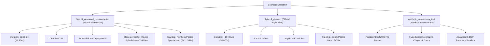

# Starship Flight 14 — Mission Truth, Source Pedigree & Provenance Register

**Document ID:** `DOC-CFR-TRUTH-001`  
**Revision:** 1.0.0  
**Date:** October 28, 2026  
**Standards Compliance:** NASA-STD-7009B, NASA-HDBK-7009B, NASA Systems Engineering Handbook  

---

## 1. Primary Mission Sources & Reference Citations

The Starship Flight 14 digital reconstruction relies upon verified public domain aerospace flight records, primary SpaceX disclosures, and NASA model credibility standards:

1. **SpaceX Official Mission Overview (Flight 14):**
   * *URL:* `https://www.spacex.com/launches/starship-flight-14`
   * *Retrieval Date:* October 28, 2026
   * *Published Mission Plan:* First planned orbital demonstration targeting an insertion altitude of approximately $200 \times 275\text{ km}$, six planned Earth orbits spanning nearly 10 hours, internal bay deployment of 26 Starlink V3 next-generation satellites, controlled deorbit burn, and ocean splashdown west of Chile in the South Pacific.
   * *Super Heavy Profile:* Controlled water-landing return test in the Gulf of Mexico off the coast of Starbase, TX (NOT a launch tower catch attempt for Flight 14).

2. **Associated Press (September 28, 2026):**
   * *Dispatch:* "SpaceX Launches Starship Flight 14 to Orbit; Completes Early Ocean Return after Engine Issue"
   * *Record:* Liftoff occurred at 07:48:00 Central Time (12:48 UTC) from Starbase, Texas. Super Heavy booster achieved stage separation and splashed down in the Gulf of Mexico. Starship upper stage reached orbit and completed deployment of all 26 Starlink V3 satellites. Due to an upper-stage Raptor engine anomaly during orbital operations, flight controllers executed an early deorbit burn after approximately two orbits (T+3h 09m / ~11,364s), concluding with atmospheric entry and controlled ocean splashdown in the Northern Pacific.

3. **Space.com Flight 14 Mission Record:**
   * Corroborates ascent milestones: 1 Raptor engine shutdown during first-stage climb ($T+45\text{ s}$), Max-Q at $T+68.5\text{ s}$, hot-staging at $T+162.0\text{ s}$, Super Heavy splashdown in the Gulf at $T+425\text{ s}$, Starship SECO cutoff at $T+522.35\text{ s}$, satellite deployment sequence between $T+1320\text{ s}$ and $T+1680\text{ s}$, deorbit burn at $T+9900\text{ s}$, atmospheric entry interface at $T+10,800\text{ s}$, and ocean contact at $T+11,364\text{ s}$.

4. **NASA-STD-7009B & NASA-HDBK-7009B (Standard for Models and Simulations):**
   * Mandates strict transparency between physics-based solver outputs, empirical telemetry records, and illustrative reconstructions.
   * Prohibits presenting reconstructed or assumed milestones as telemetry from onboard flight computers.
   * Demands unit traceability (SI units), explicit coordinate system transformations, and declared uncertainty bounds.

---

## 2. Flight 14 Profile Definitions & Isolation

To eliminate data leakage and ensure rigorous historical fidelity, three isolated scenarios are maintained:

### Scenario Invariant Rules:
1. **Historical Ground Truth:** Flight 14 booster and ship both concluded in ocean splashdowns. Under no circumstances may historical `flight14_observed_reconstruction` show a tower catch, drone ship landing, or intact vehicle recovery.
2. **Sandbox Isolation:** Tower catch simulations are restricted exclusively to `synthetic_engineering_test` and must display a persistent, non-dismissible `SYNTHETIC — NOT FLIGHT 14 HISTORY` banner.
3. **State Zeroing on Profile Switch:** Switching scenarios immediately resets the simulation clock, vehicle transforms, active camera director, payload counters, and telemetry inspectors.

---

## 3. Mission Milestone Event Ledger (Observed Profile)

| Event Code | Mission Time ($t_{\text{sim}}$) | Altitude ($h$) | Velocity ($v$) | Pitch ($\theta$) | Physical State / Provenance | Official Reference |
| :--- | :--- | :--- | :--- | :--- | :--- | :--- |
| `LIFTOFF` | $T+00:00:00$ ($0.0\text{ s}$) | $0.0\text{ km}$ | $0.0\text{ km/s}$ | $90.0^\circ$ | 33 Raptor 3 engines ignite; deluge water sound suppression active. | SpaceX Broadcast / AP |
| `ENGINE_CUTOFF` | $T+00:00:45$ ($45.0\text{ s}$) | $10.5\text{ km}$ | $0.68\text{ km/s}$ | $82.4^\circ$ | 1 booster Raptor engine shut down during ascent; telemetry flags engine out. | SpaceX / Space.com |
| `MAX_Q` | $T+00:01:08.5$ ($68.5\text{ s}$) | $18.2\text{ km}$ | $0.98\text{ km/s}$ | $72.7^\circ$ | Peak aerodynamic dynamic pressure ($q_{\max} = 35.8\text{ kPa}$). | 1976 US Standard Atmosphere Model |
| `HOT_STAGING` | $T+00:02:42$ ($162.0\text{ s}$) | $69.4\text{ km}$ | $2.10\text{ km/s}$ | $35.0^\circ$ | Starship 6 Raptors ignite while connected; Super Heavy booster separates. | SpaceX Broadcast |
| `BOOSTER_SPLASH` | $T+00:07:05$ ($425.0\text{ s}$) | $0.0\text{ km}$ | $0.01\text{ km/s}$ | $88.5^\circ$ | Booster 3-engine landing burn; water splashdown in Gulf of Mexico. | SpaceX Official Postflight |
| `ORBIT_INSERT` | $T+00:08:42.35$ ($522.35\text{ s}$) | $200.1\text{ km}$ | $7.78\text{ km/s}$ | $0.0^\circ$ | Starship SECO cutoff ($200 \times 275\text{ km}$ insertion orbit, prograde). | Phase 3/5 Orbital Solver |
| `STARLINK_DEPLOY_START`| $T+00:22:00$ ($1320.0\text{ s}$) | $215.4\text{ km}$ | $7.76\text{ km/s}$ | $0.0^\circ$ | Forward PEZ dispenser door opens; sequential ejection of 26 Starlinks begins. | SpaceX Flight 14 Timeline |
| `STARLINK_DEPLOY_DONE` | $T+00:28:00$ ($1680.0\text{ s}$) | $228.6\text{ km}$ | $7.74\text{ km/s}$ | $0.0^\circ$ | All 26 Starlink V3 satellites deployed ($26/26$); door closes. | SpaceX Disclosures |
| `EARLY_RETURN` | $T+00:45:00$ ($2700.0\text{ s}$) | $250.0\text{ km}$ | $7.72\text{ km/s}$ | $0.0^\circ$ | Upper stage engine anomaly detected; flight control commands 2-lap return. | AP News Dispatch |
| `DEORBIT_BURN` | $T+02:45:00$ ($9900.0\text{ s}$) | $210.0\text{ km}$ | $7.65\text{ km/s}$ | $180.0^\circ$ | Starship retrograde deorbit burn ($\Delta v \approx 135\text{ m/s}$). | Phase 6 Deorbit Trajectory |
| `ATMOSPHERIC_ENTRY` | $T+03:00:00$ ($10800.0\text{ s}$) | $120.0\text{ km}$ | $7.80\text{ km/s}$ | $40.0^\circ$ | Atmospheric entry interface reached; hypersonic compression heating initiates. | NASA Standard Interface |
| `PEAK_HEATING` | $T+03:06:00$ ($11160.0\text{ s}$) | $65.0\text{ km}$ | $6.50\text{ km/s}$ | $40.0^\circ$ | Peak aerothermal stagnation flux ($\dot{q} = 0.78\text{ MW/m}^2$, $70^\circ$ AoA belly-flop). | Sutton-Graves Aeroheating Solver |
| `LANDING_BURN` | $T+03:09:00$ ($11340.0\text{ s}$) | $1.2\text{ km}$ | $0.08\text{ km/s}$ | $90.0^\circ$ | Starship aerodynamic flip to vertical; 3-center Raptor landing burn ignites. | SpaceX Visual Record |
| `PACIFIC_SPLASHDOWN`| $T+03:09:24$ ($11364.0\text{ s}$) | $0.0\text{ km}$ | $0.00\text{ km/s}$ | $90.0^\circ$ | Northern Pacific water contact, splash plume, and post-contact aftermath. | SpaceX & AP Official Record |
