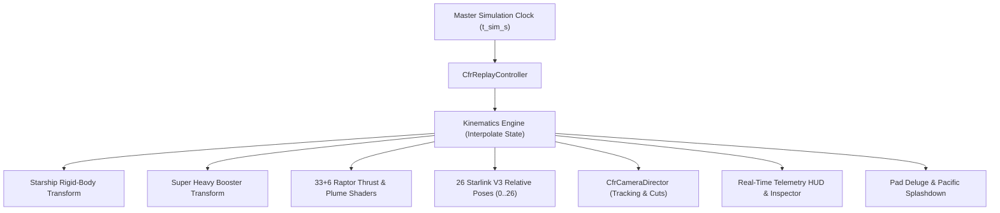

# Starship Flight 14 — Replay State Data Contract & Architecture

**Document ID:** `DOC-CFR-DATA-001`  
**Revision:** 1.0.0  
**Date:** October 28, 2026  
**Target Environment:** Three.js / WebGL / Common Expression Engine  

---

## 1. Single Authoritative Timebase

All visual, physical, kinematic, HUD, camera, and payload systems derive from a **single simulation time clock** ($t_{\text{sim\_s}}$). Under no circumstances may independent UI timers, requestAnimationFrame wall-clock accumulators, or client-side real-time timers desynchronize from $t_{\text{sim\_s}}$.



---

## 2. Telemetry Channel Schema & Provenance

Every telemetry channel exported by `adapter.py` and evaluated by `replay_controller.js` satisfies the strict data contract:

```typescript
interface CfrStateRecord {
  time_s: number;               // [s] Mission Elapsed Time from T=0
  altitude_km: number;          // [km] WGS-84 geodetic altitude: ||r|| - R_earth
  velocity_km_s: number;        // [km/s] Inertial velocity magnitude: ||v_ECI||
  mach: number;                 // [-] Ratio of airspeed to local acoustic speed
  dynamic_pressure_kpa: number; // [kPa] q = 0.5 * rho * v_rel^2
  heat_flux_mw_m2: number;      // [MW/m^2] Convective stagnation point heat flux
  apparent_g: number;           // [g] Proper contact acceleration: ||F_thrust + F_aero|| / (m * g0)
  thrust_mn: number;            // [MN] Instantaneous propulsive thrust
  mass_tonnes: number;          // [t] Total vehicle mass (dry + propellants + payload)
  pitch_deg: number;            // [deg] Pitch angle relative to local horizon (90°=vertical, 0°=horizontal)
  flaps_fwd_deg: number;        // [deg] Forward canard deflection angle
  flaps_aft_deg: number;        // [deg] Aft body flap deflection angle
  surface_temp_k: number;       // [K] Radiative equilibrium TPS outer tile surface temperature
  bondline_temp_k: number;      // [K] Structural backing bondline temperature
  phase: string;                // Mission flight phase identifier
  scene_pos: [number, number, number]; // Three.js scene coordinates (1 unit = 1000 km)
}
```

---

## 3. Discontinuous Event Boundaries & Interpolation Rules

1. **Spatial Interpolation:** Position and velocity between discrete solver steps $t_k \le t < t_{k+1}$ interpolate linearly:
   $$\mathbf{r}(t) = \mathbf{r}_k + u \cdot (\mathbf{r}_{k+1} - \mathbf{r}_k), \quad u = \frac{t - t_k}{t_{k+1} - t_k}$$
2. **Attitude Kinematics:** Pitch angle interpolates smoothly between state records. At $u=0$, $\theta = \theta_k$; at $u=1$, $\theta = \theta_{k+1}$.
3. **Discrete Event Invariance:**
   * **Staging ($T=162\text{ s}$):** State ownership splits into two independent rigid bodies (`starshipUpperGroup` and `boosterGroup`). No interpolation bridges across staging mass loss or stage separation impulse.
   * **Engine Cutoffs (MECO, SECO):** Thrust drops discontinuously to zero at engine cutoff time without lagging ramp.
   * **Satellite Deployment ($T=1320\text{ s}$ to $T=1680\text{ s}$):** Each of the 26 satellites instantiates only when $t \ge t_{\text{deploy}, i}$. When scrubbing backward, satellites with $t < t_{\text{deploy}, i}$ immediately become invisible and return to the dispenser bay.
   * **Ocean Contact ($T=11,364\text{ s}$):** At touchdown, altitude clamps to $0.0\text{ km}$, velocity halts to $0.0\text{ km/s}$, and splashdown plume/ocean boil triggers.
